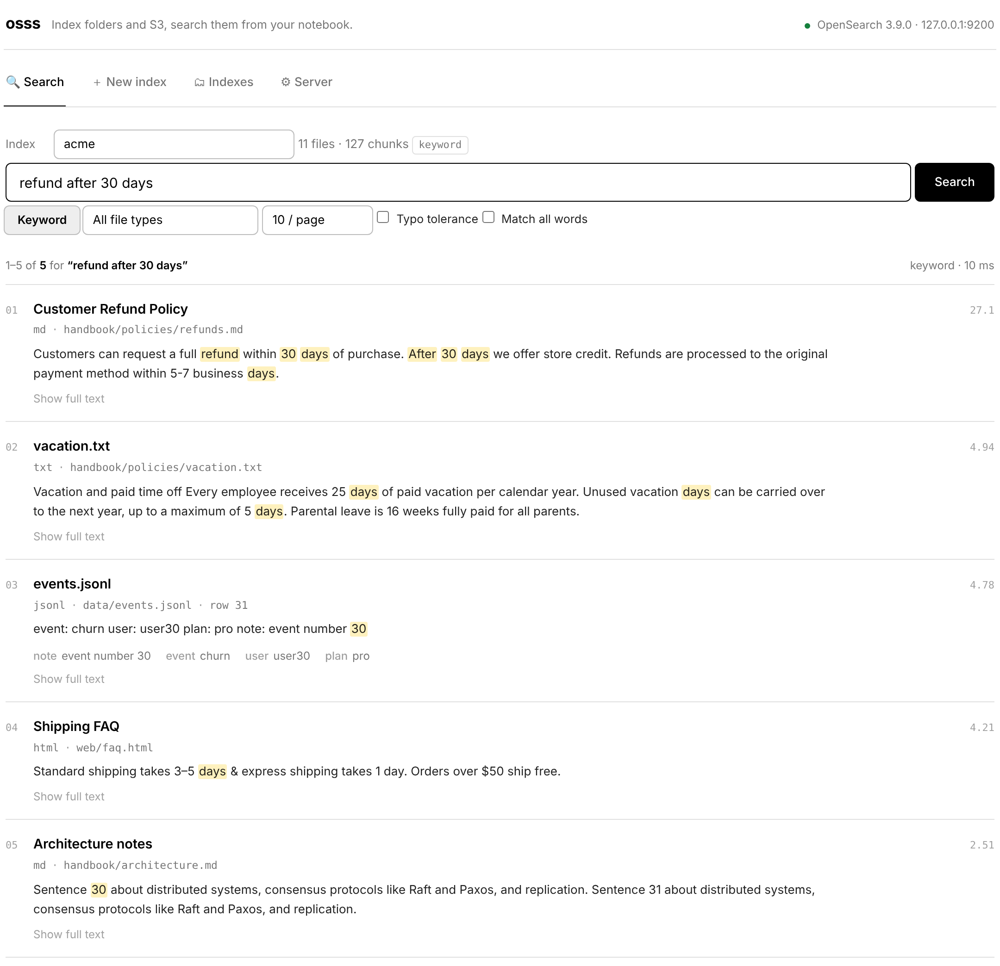
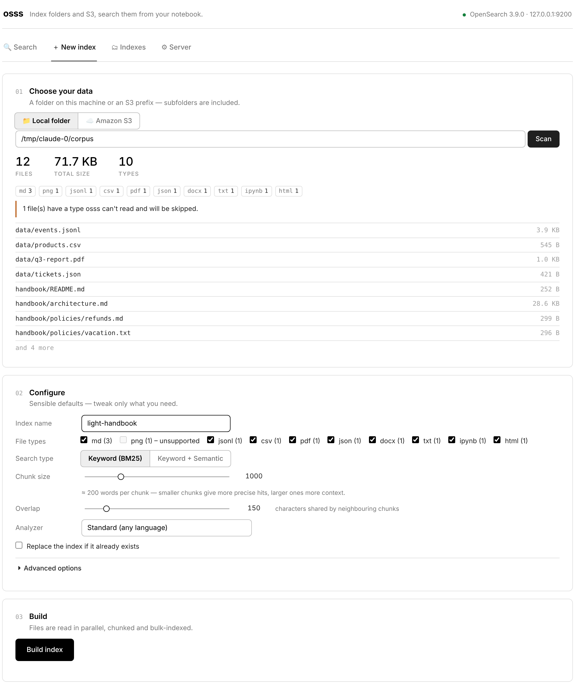
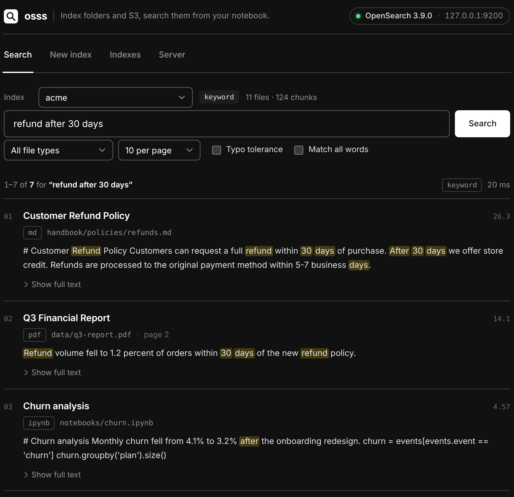

# osss

**OpenSearch in your notebook.** Point it at an S3 prefix or a local folder, pick a few options, and search. Works in SageMaker (Studio and notebook instances), JupyterLab, VS Code, Colab and plain Python.

**📖 Documentation: [utkarsh5026.github.io/osss](https://utkarsh5026.github.io/osss/)**: installation, a 5-minute quickstart, a guide to the app, and a SageMaker guide.

```python
%pip install -q "osss @ git+https://github.com/utkarsh5026/osss.git"
```

```python
import osss

osss.ui()  # the point-and-click app: start OpenSearch, build an index, search
```

<p align="center"></p>

## Why

- **One command, nothing else to install.** `osss.start()` runs OpenSearch for you. It uses Docker when a Docker daemon is available. Otherwise it downloads the official OpenSearch tarball, which ships its own Java. That includes SageMaker Studio, which can't run containers.
- **Any folder or bucket.** PDF, Word, Markdown, HTML, text, code, notebooks, CSV/TSV, JSON/JSONL, Parquet. Hidden files, `.git` and `node_modules` are skipped automatically.
- **Real configuration, sensible defaults.** You control chunking, the language analyzer, file-type and glob filters, which columns to search for CSV/JSON, shards and replicas, and embeddings.
- **Keyword, semantic or hybrid search.** BM25 out of the box. Add embeddings from a local sentence-transformers model or Amazon Bedrock (Titan, Cohere) for semantic search; hybrid fuses both with reciprocal rank fusion.
- **Survives kernel restarts.** The server keeps running, and indexes live on disk. Re-running `osss.start()` reconnects in about a second.

## Quick start (Python)

```python
import osss

cluster = osss.start()                         # first run downloads OpenSearch (~250 MB)

idx = cluster.create_index(
    "handbook",
    "s3://my-bucket/handbook/",                # or a local folder: "./docs"
    include=["*.pdf", "*.md", "*.docx"],
    chunk_size=800, chunk_overlap=120,
    analyzer="english",
)

idx.search("how many vacation days do I get?")           # renders as result cards
idx.search("refund", file_type="pdf", fuzzy=True, k=20)  # filters, typo tolerance
idx.search("tent", filters={"fields.category": "camping"})  # filter on CSV/JSON columns
```

Results are plain Python objects too:

```python
res = idx.search("quarterly revenue")
res[0].title, res[0].path, res[0].page, res[0].score
res.to_pandas()            # DataFrame
res.context()              # numbered, cited text, ready to paste into an LLM prompt (RAG)
```

### Metadata (Bedrock-compatible)

Tag every chunk of a file and filter on it. Put a `<file>.metadata.json` sidecar next to a file, in the same format as Amazon Bedrock Knowledge Bases, or pass `metadata=` in Python:

```jsonc
// s3://my-bucket/handbook/leave-policy.pdf.metadata.json
{"metadataAttributes": {"department": "hr", "year": 2024, "tags": ["leave", "benefits"]}}
```

```python
idx = cluster.create_index("handbook", "s3://my-bucket/handbook/",
                           metadata=lambda f: {"team": f.folder})   # or a plain dict
idx.search("parental leave", metadata={"department": "hr", "year": {"gte": 2023}})
res[0].metadata            # {"department": "hr", "year": 2024, ...}
```

Add new or changed files later. Re-indexing a file replaces its old chunks, so this is safe to re-run:

```python
idx.add("s3://my-bucket/handbook/2025/")
```

### Semantic & hybrid search

```python
%pip install -q "osss[semantic] @ git+https://github.com/utkarsh5026/osss.git"   # local models

cluster = osss.start(semantic=True)            # adds the k-NN plugin (one-time ~1 GB download)
idx = cluster.create_index("handbook-ai", "s3://my-bucket/handbook/", semantic=True)
idx.search("can I carry leave over to next year?")         # hybrid by default
idx.search("...", mode="semantic")
```

Prefer not to run models locally? Use Bedrock with your SageMaker role:

```python
cluster.create_index("kb", "s3://bucket/kb/", semantic=True,
                     embedding_model="amazon.titan-embed-text-v2:0")
```

Or bring any embedding function:

```python
emb = osss.FunctionEmbedder(lambda texts: my_model.encode(texts), name="my-model")
cluster.create_index("kb", "./docs", embedder=emb)
```

### Use an existing cluster

```python
cluster = osss.connect("https://search-my-domain.us-east-1.es.amazonaws.com")   # SigV4 signed automatically
cluster = osss.connect("https://my-collection.us-east-1.aoss.amazonaws.com")    # OpenSearch Serverless
cluster = osss.connect("https://localhost:9200", username="admin", password="…", verify_certs=False)
```

## The notebook app

`osss.ui()` has four tabs:

| Tab | What it does |
| --- | --- |
| 🔍 Search | Pick an index, then search with keyword, semantic or hybrid mode. Filter by file type, page through results, and expand any hit to see the full chunk. |
| ＋ New index | **01** Choose a local folder or S3 prefix and scan it to preview files and types. **02** Configure the index. **03** Build it with live progress, a cancel button and a summary of what was skipped. |
| 🗂 Indexes | See every index with its size and health. Inspect, add files, or delete. |
| ⚙ Server | Start or stop the local OpenSearch and choose memory, port and backend, or connect to a remote cluster. |

<p align="center">
  
  
</p>

The app follows your JupyterLab theme (light or dark). Every object also renders on its own in a cell: `cluster`, `idx`, `idx.search(...)`, `osss.LocalServer()`.

## Command line

```bash
osss start                                  # or: osss start --semantic --heap 2g
osss index s3://bucket/docs --name docs --include '*.pdf' '*.md' --chunk-size 800
osss search docs "refund policy" -k 5
osss list
osss doctor                                 # checks memory, disk, Docker, AWS credentials, extras
osss stop
```

## Configuration reference

All of these can be passed to `create_index(...)`, set in the app, or passed as CLI flags.

| Option | Default | Meaning |
| --- | --- | --- |
| `include` / `exclude` | all / hidden + caches | Glob patterns, e.g. `["*.pdf", "reports/**"]` |
| `file_types` | every supported type | e.g. `["pdf", "md"]` |
| `chunk_size` / `chunk_overlap` | `1000` / `150` | Characters per chunk; `0` indexes whole documents |
| `analyzer` | `standard` | `english`, `french`, `german`, `cjk`, `whitespace`, … |
| `semantic` | `False` | Store embeddings for semantic and hybrid search |
| `embedding_model` | `all-MiniLM-L6-v2` | Any sentence-transformers or Bedrock model id |
| `text_fields` / `title_field` / `id_field` | auto | Which CSV/JSON/Parquet columns to search, use as the title, or use as a stable id |
| `metadata_files` | `True` | Read `<file>.metadata.json` sidecars (Bedrock format) and attach them to every chunk |
| `max_file_mb` | `100` | Skip larger files |
| `workers` | `8` | Parallel readers (S3 downloads benefit most) |
| `shards` / `replicas` | `1` / `0` | OpenSearch index settings |

Server options for `osss.start(...)`: `semantic`, `heap="1g"`, `port=9200`, `backend="auto" | "docker" | "tarball"`, `version="3.9.0"`. Data lives in `~/.osss`, or in `/opt/osss` when running as root; set `OSSS_HOME` to change this. Set `OSSS_DOCKER_IMAGE` to use a mirrored image.

## SageMaker notes

- **Studio (JupyterLab):** Docker isn't available, so osss uses the tarball. If the kernel runs as root (Studio Classic or custom images), osss starts OpenSearch as the unprivileged `nobody` user, since OpenSearch refuses to run as root.
- **Notebook instances:** Docker is available and used. To preinstall osss on every start, add this to a lifecycle configuration:
  ```bash
  sudo -u ec2-user -i <<'EOF'
  source /home/ec2-user/anaconda3/bin/activate python3
  pip install -q "osss @ git+https://github.com/utkarsh5026/osss.git"
  EOF
  ```
- **S3 and Bedrock** use the notebook's execution role; no keys are needed.
- **Memory:** the default heap is 1 GB, which fits on `ml.t3.medium`. Use `osss.start(heap="512m")` on very small instances or `"4g"` for millions of chunks.
- **No internet?** Copy the OpenSearch tarball into `$OSSS_HOME/downloads/`, or use `osss.connect()` with an Amazon OpenSearch Service domain in your VPC.

## Development

```bash
pip install -e ".[dev]"
pytest                                        # fast unit tests
OSSS_TEST_LOCAL=1 pytest -m integration       # starts a real OpenSearch
pip install -e ".[docs]" && mkdocs serve      # docs at http://127.0.0.1:8000
```

Apache-2.0 licensed.
