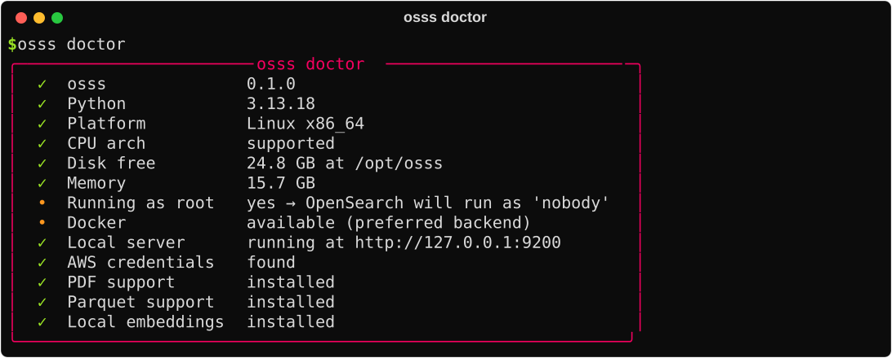
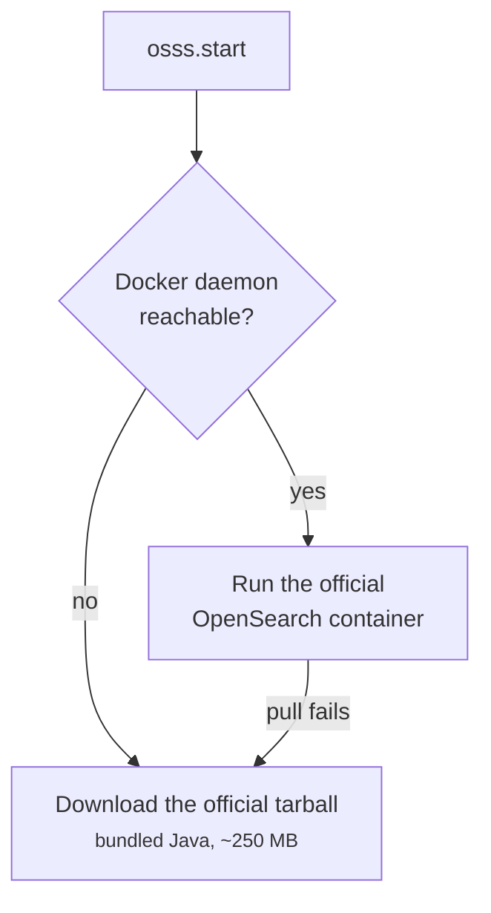

# Installation

osss is a single Python package. Installing it is the only setup you do; osss downloads OpenSearch itself the first time you start it.

## Install

=== "In a notebook"

    Run this in a cell. It works in SageMaker, JupyterLab, VS Code and Colab:

    ```python
    %pip install -q "osss @ git+https://github.com/utkarsh5026/osss.git"
    ```

    !!! tip "Restart the kernel?"
        Not needed for a fresh install. If you're **upgrading**, restart the kernel so the new version is loaded.

=== "In a terminal"

    ```bash
    pip install "osss @ git+https://github.com/utkarsh5026/osss.git"
    ```

    This also installs the `osss` [command-line tool](../guide/cli.md).

That's everything you need for keyword search over PDFs, Office files, text, HTML, notebooks, CSV and JSON, from local folders or S3.

## Optional extras

Add an extra in square brackets when you need it:

| Extra | Adds | Install |
| --- | --- | --- |
| `semantic` | Local embedding models (sentence-transformers) for [semantic search](../guide/semantic.md) | `pip install "osss[semantic] @ git+…"` |
| `parquet` | Reading `.parquet` files | `pip install "osss[parquet] @ git+…"` |
| `all` | All of the above | `pip install "osss[all] @ git+…"` |

!!! note "Using Amazon Bedrock for embeddings?"
    You don't need the `semantic` extra. Bedrock models run in AWS; osss only calls the API.

## Check your setup

```bash
osss doctor
```

{ .cli }

`doctor` checks your Python version, memory, free disk, whether Docker is available, AWS credentials (for S3 and Bedrock) and which optional extras are installed.

## Requirements

- **Python 3.9 or newer.**
- **Linux or macOS.** On Linux nothing else is needed. On macOS and Windows, osss runs OpenSearch in Docker, so install Docker Desktop.
- **About 2 GB of free RAM and 1 GB of disk** for keyword search. Semantic search needs about 1 GB more disk for the k-NN plugin, plus room for the embedding model.

## How OpenSearch gets installed

The first time you call `osss.start()`, osss chooses how to run OpenSearch:



- **Docker available** (your laptop, a SageMaker notebook instance, EC2): the official `opensearchproject/opensearch` image runs with a persistent data volume.
- **No Docker** (SageMaker Studio, Colab, most hosted notebooks): the official tarball is downloaded once. It includes its own Java, so nothing else needs installing.

Either way, later starts reuse what's already downloaded. More details are on [Running OpenSearch](../guide/server.md).

## Uninstall

```python
import osss
osss.LocalServer().uninstall()      # stops the server, deletes OpenSearch and all indexes
```

```bash
pip uninstall osss
```

<div class="next" markdown>
[Next: 5-minute quickstart →](quickstart.md){ .md-button .md-button--primary }
</div>
