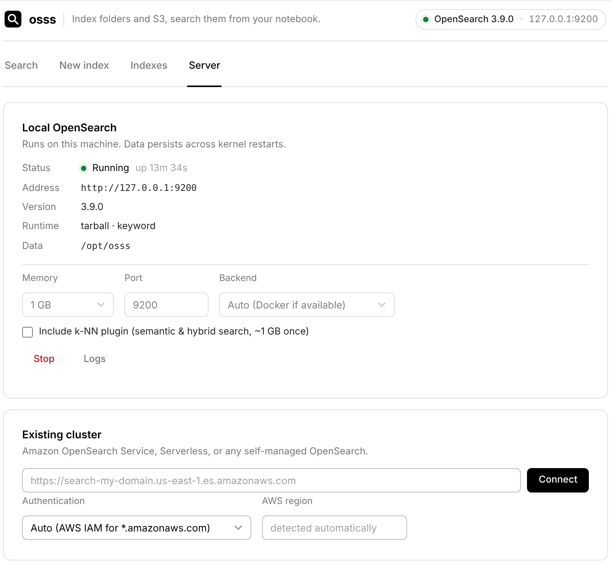
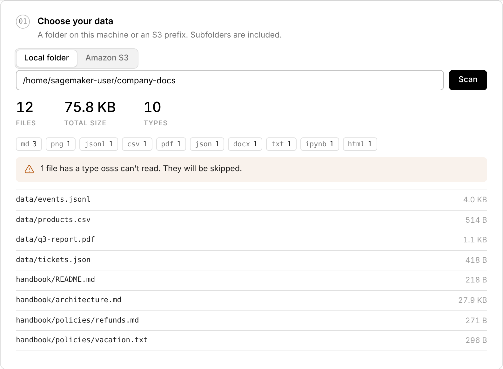
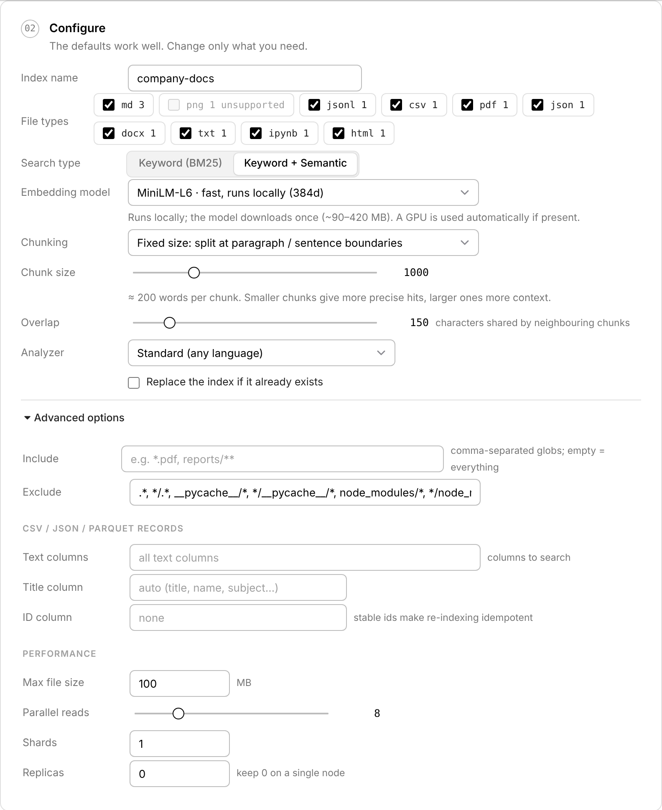
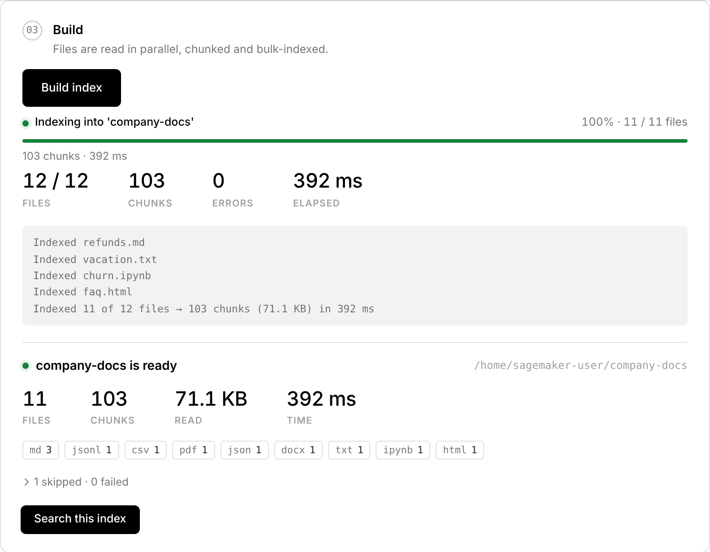
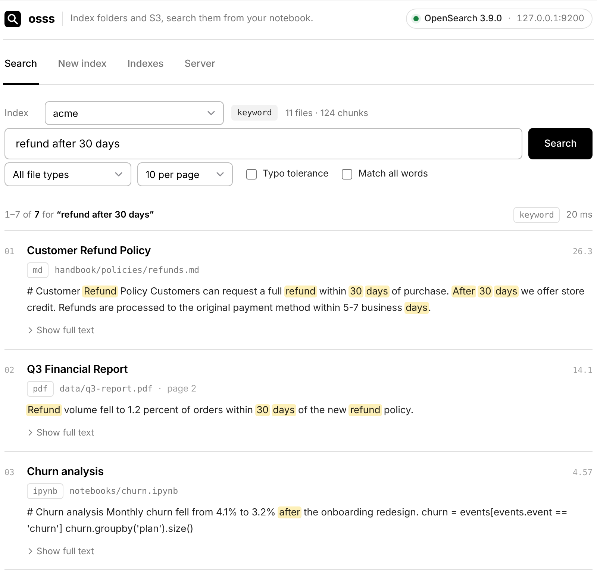
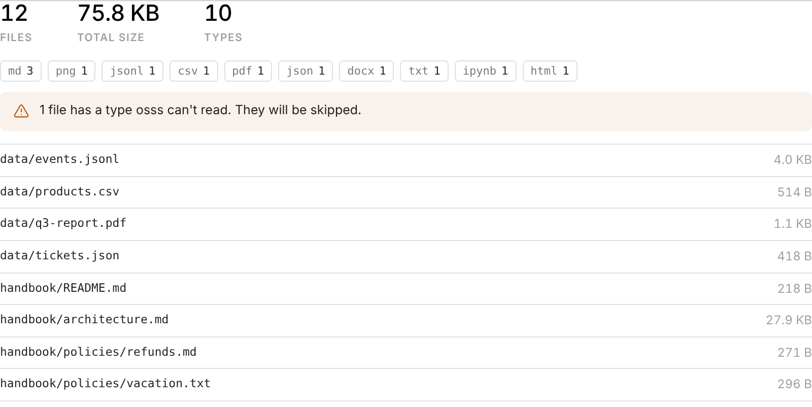
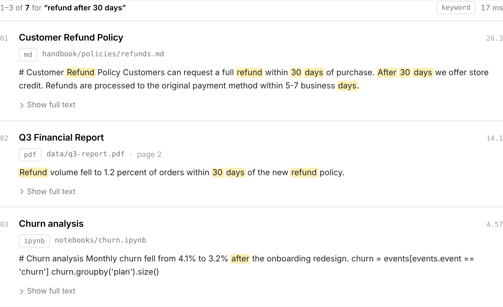

---
hide:
  - toc
---

# 5-minute quickstart

By the end of this page you'll have a running OpenSearch, an index built from your own files, and search results in your notebook. Choose whether you prefer clicking or code; both reach the same place.

=== ":material-cursor-default-click: With the app"

    <div class="steps" markdown>

    ### Open the app

    In a notebook cell:

    ```python
    import osss
    osss.ui()
    ```

    The first time, the app opens on the **Server** tab, because there's no OpenSearch running yet.

    ### Start OpenSearch

    Click **Start OpenSearch**. The first start downloads OpenSearch (about 250 MB, once) and takes a minute or two; later starts take seconds.

    { .shot }

    !!! tip
        Tick **Include k-NN plugin** if you want [semantic search](../guide/semantic.md). You can also turn it on later; osss upgrades the server for you.

    ### Choose your data

    Open **New index**. Choose **Local folder** or **Amazon S3**, paste a path, and click **Scan**. You'll see how many files there are, their types and their total size, before anything is indexed.

    { .shot }

    ### Configure (or keep the defaults)

    Give the index a name, untick file types you don't want, and pick a search type. The defaults work well for most document collections. See [Building an index](../guide/indexing.md) for what each option does.

    { .shot }

    ### Build

    Click **Build index**. Files are read in parallel and you can watch progress live. When it's done you get a summary, including any files that were skipped and why.

    { .shot }

    ### Search

    Click **Search this index**, type a question and press ++enter++. Matches are highlighted, and every hit shows its file, page or row.

    { .shot }

    </div>

=== ":material-language-python: With Python"

    <div class="steps" markdown>

    ### Start OpenSearch

    ```python
    import osss

    cluster = osss.start()        # downloads on first use, then reconnects instantly
    ```

    ### Preview your data (optional)

    ```python
    cluster.scan("s3://my-bucket/handbook/")      # or a local folder: "./docs"
    ```

    { .shot }

    ### Build an index

    ```python
    idx = cluster.create_index(
        "handbook",
        "s3://my-bucket/handbook/",
        include=["*.pdf", "*.md", "*.docx"],   # optional
        chunk_size=800,                         # optional
    )
    ```

    A progress bar shows while it runs, and `idx.last_report` holds the summary.

    ### Search

    ```python
    idx.search("how many vacation days do I get?")
    ```

    In a notebook, results display as cards:

    { .shot }

    Iterate over them in code, or turn them into a DataFrame:

    ```python
    for hit in idx.search("refund policy", k=5):
        print(hit.score, hit.title, hit.path, hit.page)

    idx.search("refund policy").to_pandas()
    ```

    </div>

## What just happened?

- OpenSearch is running **in the background on this machine** at `http://127.0.0.1:9200`. It keeps running if you restart the kernel; `osss.start()` simply reconnects.
- Your index is stored **on disk** (in `~/.osss`, or `/opt/osss` when you're root), so it survives restarts.
- Each file was split into **chunks** of about 1,000 characters, so results point to the exact part of a document that matched.

## Coming back later

```python
import osss
cluster = osss.start()              # reconnects in about a second
idx = cluster.index("handbook")
idx.search("…")
```

To stop OpenSearch and free its memory (your indexes are kept):

```python
osss.stop()
```

<div class="next" markdown>
[Tour the app →](../guide/app.md){ .md-button .md-button--primary }
[Search tips](../guide/searching.md){ .md-button }
[Add semantic search](../guide/semantic.md){ .md-button }
</div>
