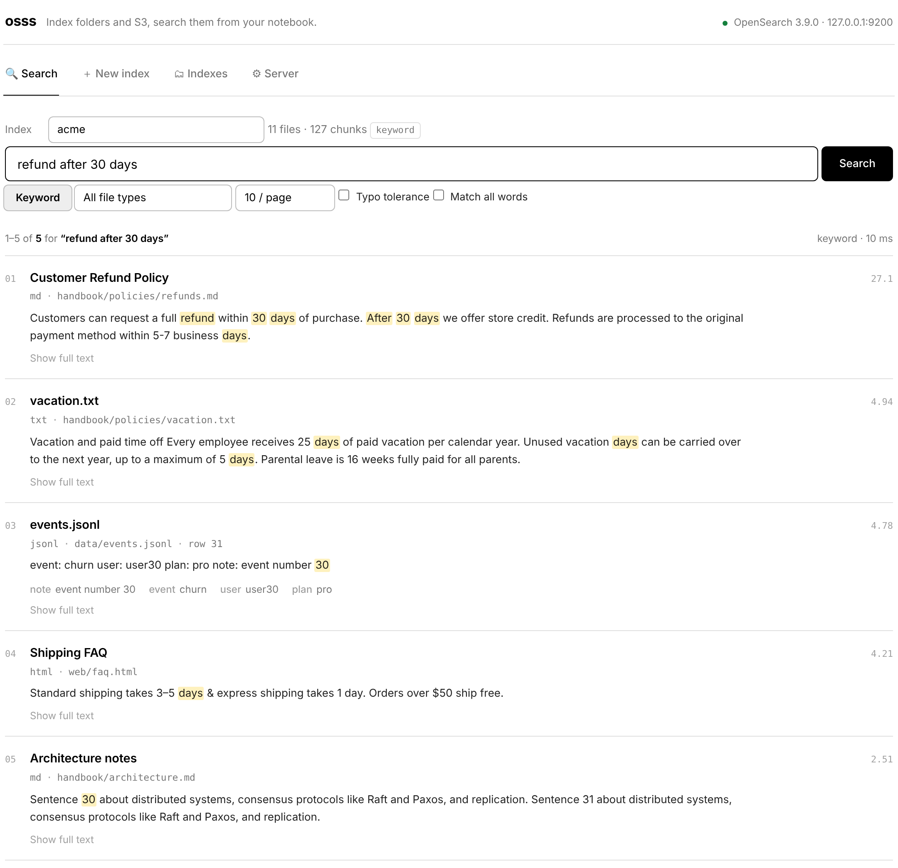
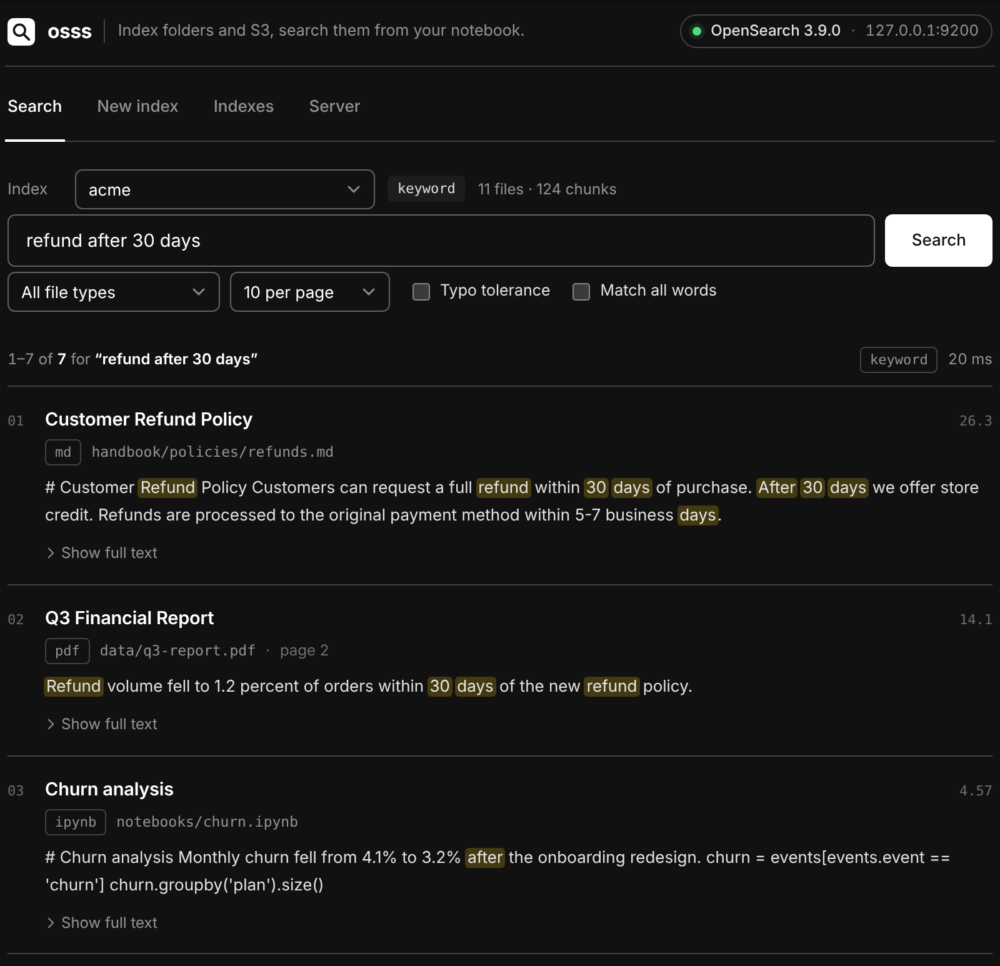
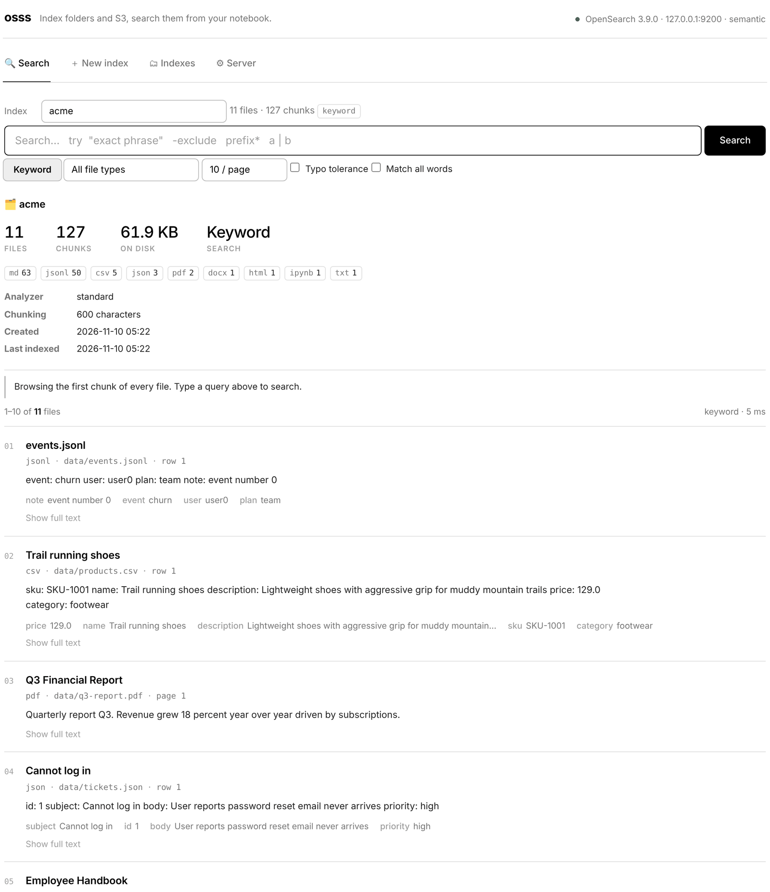
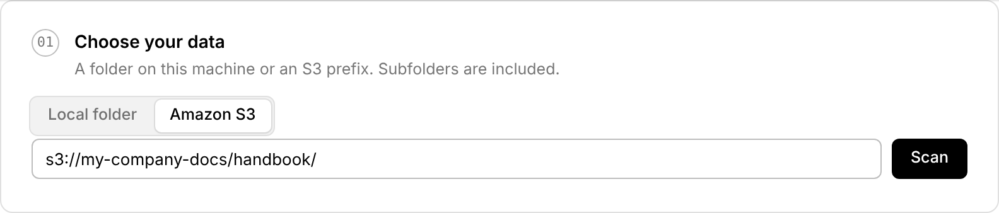
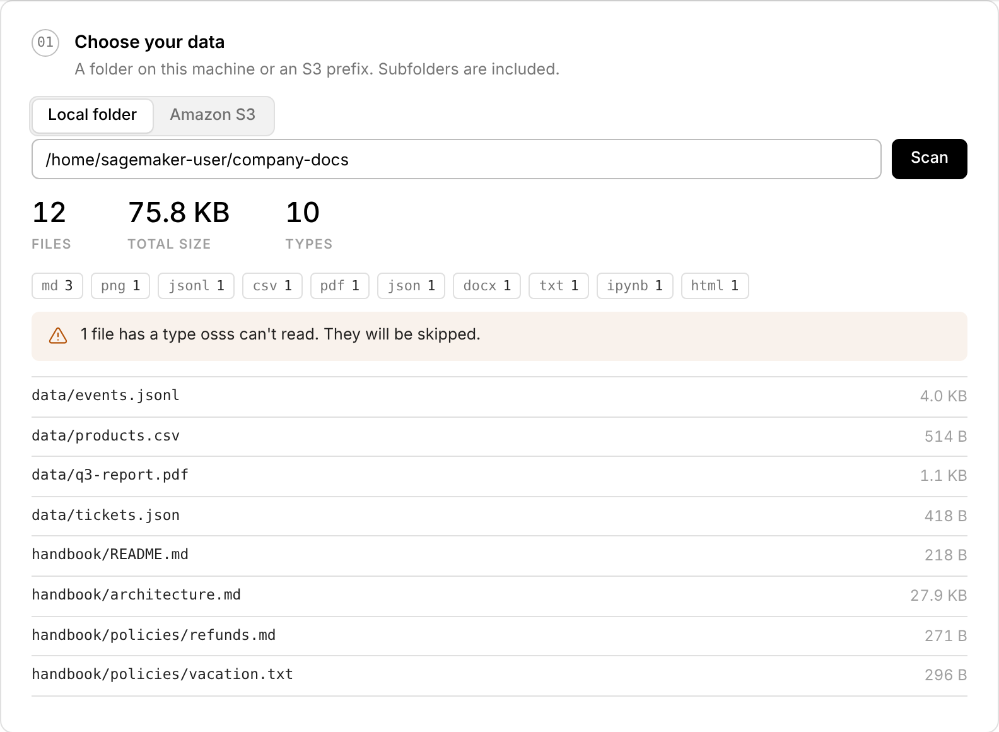
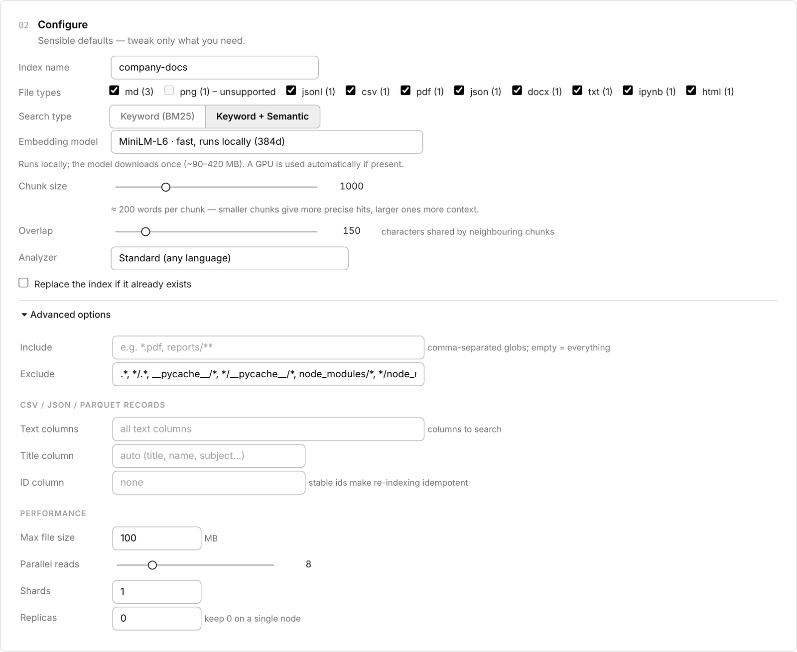
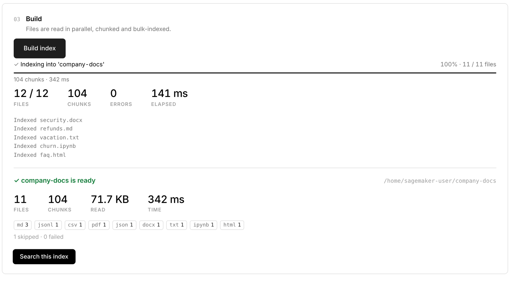
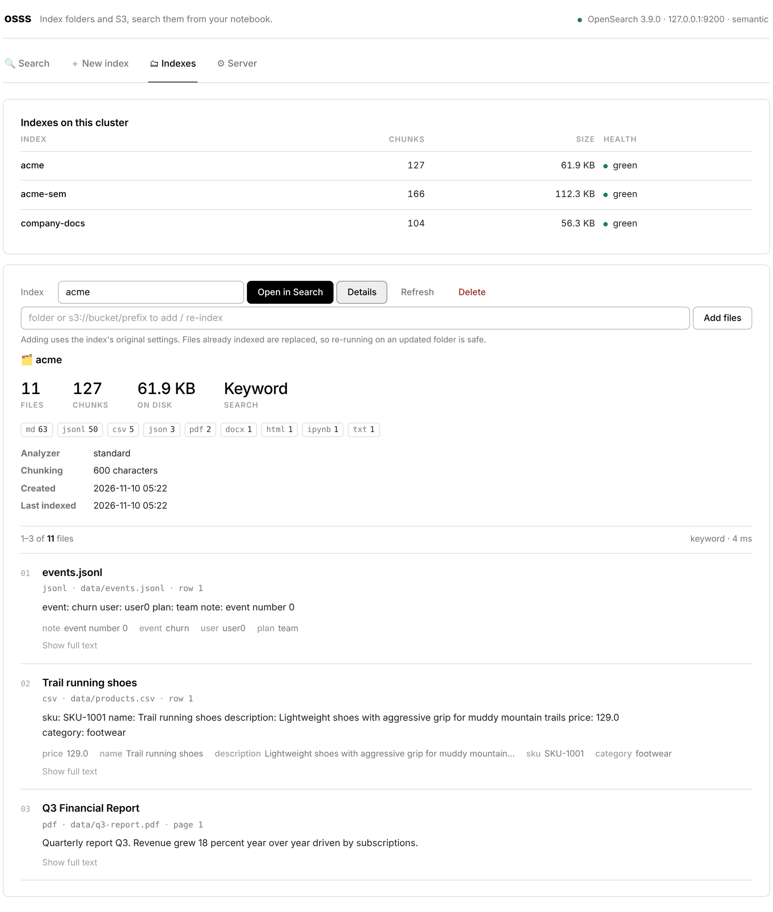
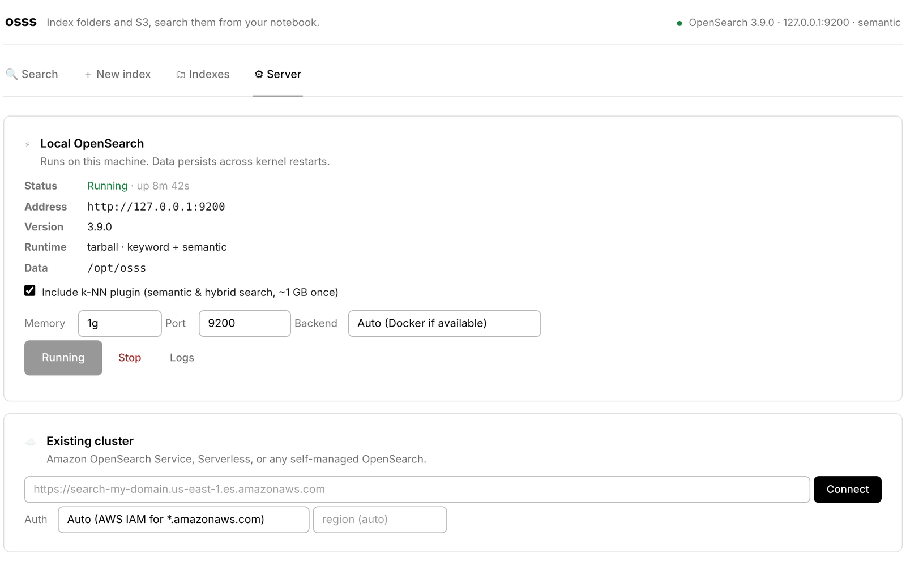

# The notebook app

```python
import osss
osss.ui()
```

The app is a small interface that lives inside a notebook cell. Everything it does is also available from [Python](../reference/api.md) and the [command line](cli.md), so you can switch whenever you like.

It has four tabs:

| Tab | Use it to |
| --- | --- |
| **🔍 Search** | Query an index, filter results and page through them |
| **＋ New index** | Point at a folder or S3 prefix, configure and build |
| **🗂 Indexes** | See what's there, add files or delete indexes |
| **⚙ Server** | Start or stop OpenSearch, or connect to an existing cluster |

The status in the top-right corner always shows what you're connected to.

!!! tip "Light and dark"
    The app follows your JupyterLab theme automatically. SageMaker Studio's dark mode works too.

## 🔍 Search

{ .shot .shot-light }
{ .shot .shot-dark }

1. **Pick an index** from the dropdown. Next to it you'll see how many files and chunks it holds, and whether it supports semantic search.
2. **Type a query** and press ++enter++, or click **Search**.
3. **Refine** with the controls below the search box:
    - **Keyword / Semantic / Hybrid** chooses how results are found. Semantic and hybrid appear only for indexes built with embeddings ([learn more](semantic.md)).
    - **All file types** limits results to PDFs only, CSV rows only, and so on.
    - **10 / page** sets how many results to show at a time.
    - **Typo tolerance** still finds `refnud` when you meant `refund`.
    - **Match all words** requires every word instead of any of them.

Each result shows:

- the **title**: the document title, a Markdown heading, or the CSV/JSON title column;
- the **file type and path**, plus the **page** (PDF) or **row** (CSV/JSON) it came from;
- a **snippet** with your search terms highlighted;
- for CSV, JSON and Parquet, the record's **fields**;
- any [custom **metadata**](metadata.md) attached to the file;
- **Show full text**, which expands the complete chunk.

With an empty search box, the tab shows an overview of the index and the first chunk of every file. It's a quick way to see what's inside.

{ .shot }

!!! tip "Query syntax"
    `"exact phrase"`, `-exclude`, `prefix*` and `this | that` all work. See [Searching](searching.md#query-syntax).

## ＋ New index

Building an index takes three steps, top to bottom.

### 01 · Choose your data

Choose **📁 Local folder** or **☁️ Amazon S3**, enter the path, and click **Scan**.

{ .shot }

The scan counts files, total size and file types, lists a sample of files, and warns about any types osss can't read. Nothing is indexed yet.

{ .shot }

### 02 · Configure

{ .shot }

| Setting | What it means | Tip |
| --- | --- | --- |
| **Index name** | The name you'll search by. It's filled in from the folder name. | Lowercase letters, numbers and `-` |
| **File types** | One checkbox per type found by the scan | Untick what you don't need |
| **Search type** | *Keyword* or *Keyword + Semantic* | Semantic adds an embedding model choice |
| **Chunk size** | Characters per searchable piece. `0` keeps whole documents. | 500–1,000 works well for prose |
| **Overlap** | Characters shared between neighbouring chunks | ~15% of the chunk size |
| **Analyzer** | How text is split into words | `English` handles plurals and tenses for English text |
| **Replace the index** | Rebuild from scratch if the name already exists | |

`<file>.metadata.json` sidecar files in the folder or bucket are read automatically, so their [metadata](metadata.md) is attached to every chunk. To filter on metadata, use `idx.search(..., metadata={...})` in a cell; the app has no metadata filter yet.

**Advanced options** include include/exclude patterns, which **CSV/JSON/Parquet columns** to search or use as the title or ID, the maximum file size, parallel reads, and shards/replicas. All of them are explained in [Building an index](indexing.md).

### 03 · Build

Click **Build index**. You'll see a live progress bar, counters for files, chunks, errors and elapsed time, and the most recent files processed. **Cancel** stops cleanly at any point.

When it finishes, a summary lists what was indexed, and any skipped or failed files with the reason. **Search this index** takes you straight to the results.

{ .shot }

## 🗂 Indexes

{ .shot }

- The table shows every index with its chunk count, size on disk and health.
- **Open in Search** jumps to the Search tab with that index selected.
- **Details** shows the index's settings, file types and a few sample documents.
- **Add files** indexes another folder or S3 prefix into the same index, using its original settings. Files that were indexed before are **replaced, not duplicated**, so re-running it after your documents change is safe.
- **Delete** asks you to click twice, so nothing is removed by accident.

## ⚙ Server

{ .shot }

**Local OpenSearch** controls the server on this machine:

- **Include k-NN plugin** turns on support for semantic and hybrid search. It's a one-time download of about 1 GB.
- **Memory** is the Java heap. `1g` fits on small instances; use `2g`–`4g` for millions of chunks.
- **Backend** is `Auto` (Docker when available, otherwise the self-contained tarball), or you can force one.
- **Logs** shows the server log if something goes wrong.

**Existing cluster** connects to Amazon OpenSearch Service, OpenSearch Serverless or any self-managed cluster. With *Auto* auth, `*.amazonaws.com` endpoints are signed with your AWS credentials (in SageMaker, the execution role).

<div class="next" markdown>
[Folders & S3 →](sources.md){ .md-button .md-button--primary }
[Building an index](indexing.md){ .md-button }
</div>
