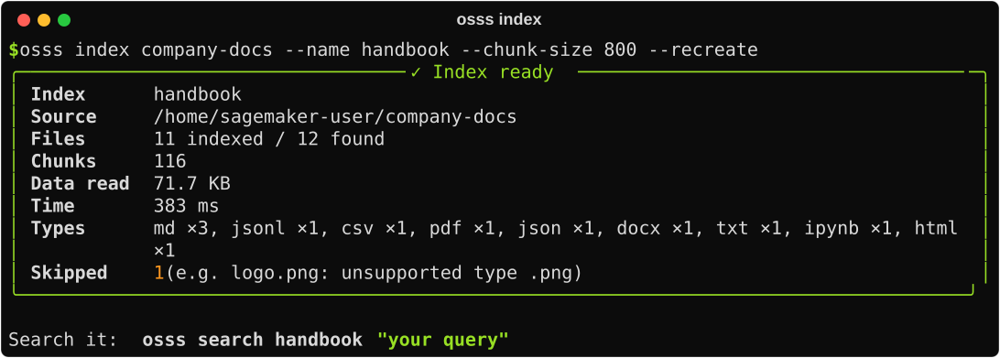
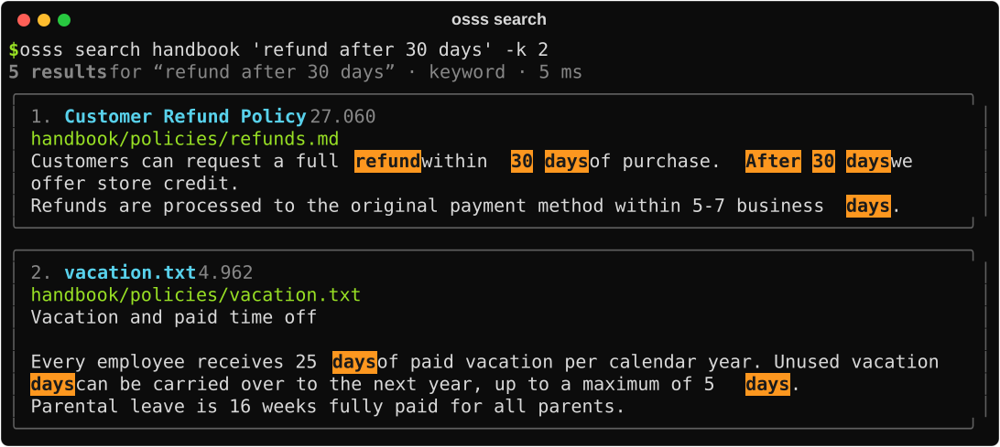
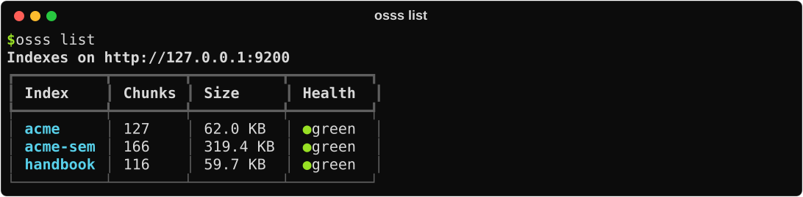

# Command line

Installing osss also installs the `osss` command. It's handy in a terminal, in scripts and in scheduled jobs.

```bash
osss --help
osss <command> --help
```

## Typical session

```bash
osss start                                         # start (or reconnect to) OpenSearch
osss index ./company-docs --name handbook          # build an index
osss search handbook "refund after 30 days"        # search it
osss stop                                          # stop when done
```

{ .cli }

{ .cli }

## Commands

### `osss start`

Start the local OpenSearch, or reconnect to it if it's already running.

| Flag | Default | |
| --- | --- | --- |
| `--semantic` | off | Include the k-NN plugin |
| `--heap` | `1g` | Java memory |
| `--port` | `9200` | |
| `--backend` | `auto` | `docker` or `tarball` |
| `--version` | `3.9.0` | OpenSearch version |

### `osss index SOURCE`

Index a folder, file or `s3://` prefix. Starts OpenSearch first if it isn't running.

| Flag | |
| --- | --- |
| `--name NAME` | Index name (default: derived from the source) |
| `--include '*.pdf' '*.md'` | Only matching files |
| `--exclude 'drafts/**'` | Also skip these (on top of the defaults) |
| `--types pdf,md` | Only these extensions |
| `--chunk-size 800` / `--overlap 120` | Chunking (`0` = whole documents) |
| `--analyzer english` | Language analyzer |
| `--semantic` / `--model ID` | Add embeddings |
| `--text-fields a,b` / `--title-field` / `--id-field` | CSV/JSON columns |
| `--meta KEY=VALUE` | [Metadata](indexing.md#custom-metadata) for every chunk; repeatable. Values are parsed as JSON when possible (`year=2024`, `ok=true`), and `a,b` becomes a list. |
| `--no-metadata-files` | Ignore `<file>.metadata.json` sidecars |
| `--recreate` | Replace the index if it exists |
| `--add` | Add to an existing index (re-indexed files are replaced) |
| `--url URL` | Use a remote cluster instead of the local one |

### `osss search INDEX "QUERY"`

| Flag | |
| --- | --- |
| `-k 20` | Number of results |
| `--mode keyword\|semantic\|hybrid` | Search mode |
| `--type pdf` | Only one file type |
| `--fuzzy` | Tolerate typos |
| `--meta KEY=VALUE` | Only chunks with this metadata; repeatable |
| `--json` | Machine-readable output |
| `--url URL` | Remote cluster |

### `osss list`

{ .cli }

### Other commands

| Command | |
| --- | --- |
| `osss scan SOURCE` | Preview files and types without indexing |
| `osss status` | Server status |
| `osss logs -n 100` | Server logs |
| `osss delete INDEX` | Delete an index (asks first; `-y` to skip) |
| `osss doctor` | Check the environment |
| `osss stop` | Stop the local server |

## Scheduling a refresh

Because `--add` replaces chunks of files that changed, a nightly refresh is one line:

```bash
osss index s3://bucket/handbook/ --name handbook --add
```

Add `OSSS_DEBUG=1` to any command to see full tracebacks.

<div class="next" markdown>
[SageMaker guide →](../sagemaker.md){ .md-button .md-button--primary }
</div>
