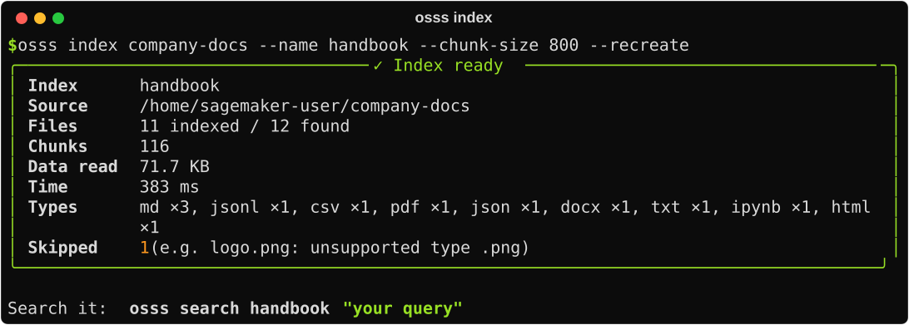

# Building an index

An **index** is a searchable copy of your documents. Building one reads every file, splits it into **chunks**, optionally computes **embeddings**, and stores everything in OpenSearch.

```python
idx = cluster.create_index(
    "handbook",                      # name
    "s3://bucket/handbook/",         # source
    chunk_size=800,                  # any option below
    analyzer="english",
)
idx.last_report                      # what was indexed, skipped or failed
```

From the app, this is the [＋ New index](app.md#new-index) tab. From the terminal, it's `osss index`.

## The build report

Every build returns a report. It renders as a summary in notebooks and as a table in the terminal:

{ .cli }

```python
r = idx.last_report
r.files_indexed, r.chunks, r.elapsed
r.skipped          # [(file, reason), ...]: unsupported type, too large, scanned PDF...
r.failed           # [(file, error), ...]: files that could not be read
r.ok               # True when nothing failed
```

A single bad file never stops a build. It's recorded, and the rest continue.

## Chunking

Long documents are split into overlapping **chunks** so that search results point to the part of a document that matches, not just the file.

| Option | Default | |
| --- | --- | --- |
| `chunk_size` | `1000` | Maximum characters per chunk. `0` disables chunking: one result per file, page or row. |
| `chunk_overlap` | `150` | Characters repeated at the start of the next chunk, so sentences that span a boundary are still found. |

osss splits at paragraph boundaries first, then lines, then sentences, then words, so chunks rarely cut a sentence in half.

!!! tip "Choosing a chunk size"
    - **Q&A over prose** (handbooks, policies, reports): `500`–`1000`.
    - **Feeding an LLM** (RAG): `800`–`1500`, so each chunk has enough context.
    - **Short records** (tickets, product rows): `0`. Each row is already a good unit.
    - Pages of a PDF and rows of a CSV are chunked separately, so a chunk never mixes two pages or two rows.

## Analyzer

The analyzer decides how text is split into searchable words.

| Analyzer | Good for |
| --- | --- |
| `standard` *(default)* | Any language. Lowercases and splits on punctuation. |
| `english` | English prose. Matches *running* with *run* and *policies* with *policy*, and ignores *the*, *a* and similar words. |
| `french`, `german`, `spanish`, `italian`, `portuguese`, `dutch`, `hindi` | Stemming for those languages |
| `cjk` | Chinese, Japanese, Korean |
| `simple` | Letters only; numbers are dropped |
| `whitespace` | Code, IDs and log lines, where punctuation matters |

The analyzer is fixed when the index is created. To change it, rebuild with `recreate=True`.

## Adding and updating files

Add more files, or pick up changes, without rebuilding:

```python
idx.add("s3://bucket/handbook/2025/")
idx.add("./handbook")             # re-run after editing files
```

`add` uses the index's original settings. Chunks from a file that was indexed before are **replaced**, not duplicated, so `add` is safe to run on a schedule. From the app, use **🗂 Indexes → Add files**. From the terminal: `osss index ./handbook --name handbook --add`.

To rebuild from scratch:

```python
cluster.create_index("handbook", "s3://bucket/handbook/", recreate=True)
```

!!! note "Deleted files"
    `add` doesn't notice files that were *removed* from the source. Rebuild with `recreate=True` to drop them.

## Custom metadata

You can tag every chunk of a file with your own attributes, such as team, year, confidentiality or product line, and filter on them when you search. This works like [metadata in Amazon Bedrock Knowledge Bases](https://docs.aws.amazon.com/bedrock/latest/userguide/kb-metadata.html), and the sidecar files are compatible, so a bucket prepared for Bedrock works as is.

### Sidecar files

Next to a file, put a JSON file with the same name plus `.metadata.json`:

```text
s3://bucket/handbook/
├── leave-policy.pdf
├── leave-policy.pdf.metadata.json
├── expenses.docx
└── expenses.docx.metadata.json
```

```json title="leave-policy.pdf.metadata.json"
{
  "metadataAttributes": {
    "department": "hr",
    "year": 2024,
    "confidential": false,
    "tags": ["leave", "benefits"]
  }
}
```

Bedrock's typed form works too:

```json
{
  "metadataAttributes": {
    "year": {"value": {"type": "NUMBER", "numberValue": 2024}, "includeForEmbedding": true}
  }
}
```

The types are `STRING`, `NUMBER`, `BOOLEAN` and `STRING_LIST`. A plain object without the `metadataAttributes` wrapper is accepted as well.

Sidecars work in local folders and in S3. They are found even when `include=["*.pdf"]` would filter them out, and they are never indexed as documents of their own. To ignore them, pass `metadata_files=False`. A sidecar with invalid JSON marks its file as **failed** in the build report, and the other files are still indexed.

!!! note
    `includeForEmbedding` is read but has no effect: metadata is stored next to each chunk and isn't mixed into the text or its embedding.

### From Python

Pass `metadata=` to `create_index` or `add`. Use a dict for the same values on every file:

```python
idx = cluster.create_index("handbook", "s3://bucket/handbook/", metadata={"source_system": "sharepoint"})
idx.add("s3://bucket/handbook-2025/", metadata={"year": 2025})
```

Or use a function that receives each file (`name`, `path`, `folder`, `ext`, `size`, `modified`, `uri`) and returns a dict:

```python
def tag(f):
    team, *_ = f.rel_path.split("/")          # "hr/leave-policy.pdf" → "hr"
    return {"team": team, "year": f.modified.year}

cluster.create_index("handbook", "s3://bucket/handbook/", metadata=tag)
```

When both are given, the sidecar wins on keys they share. Every chunk of the file gets the merged result under `metadata.<key>`.

Values can be strings, numbers, booleans, dates/datetimes (stored as ISO strings) or lists of those.

### Changing metadata

Metadata is stored on the chunks, so to change it, edit the sidecar (or the `metadata=` you pass) and re-add the file. Its chunks are replaced:

```python
idx.add("s3://bucket/handbook/leave-policy.pdf")
```

From the terminal:

```bash
osss index s3://bucket/handbook/ --meta department=hr --meta year=2024
```

See [Filters](searching.md#filters) for searching by metadata.

## Performance

| Option | Default | |
| --- | --- | --- |
| `workers` | `8` | Files read in parallel. Raise to 16–32 for S3 buckets with many small files. |
| `batch_size` | `256` | Chunks per bulk request and embedding batch |
| `max_file_mb` | `100` | Larger files are skipped |
| `shards` / `replicas` | `1` / `0` | Keep these on a single local node. Raise them only on a real cluster. |

Rough speeds on a 2-vCPU notebook: a few hundred text files per second for keyword indexes. PDFs are slower because the text is extracted page by page. With a local embedding model on CPU, expect about 100–300 chunks per second.

## Everything in one place

All options live in [`IndexConfig`](../reference/configuration.md). You can also build a config once and reuse it:

```python
from osss import IndexConfig

cfg = IndexConfig(name="handbook", include=["*.pdf"], chunk_size=800, analyzer="english")
cluster.create_index(source="s3://bucket/handbook/", config=cfg)
```

<div class="next" markdown>
[Searching →](searching.md){ .md-button .md-button--primary }
</div>
