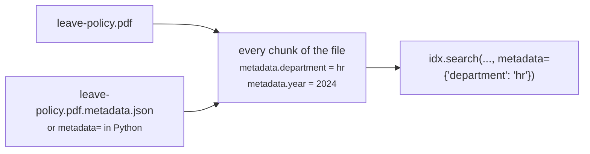

# Metadata & filtering

Attach your own attributes to documents, such as department, year, product, region, confidentiality or tags, and use them to narrow searches: *"parental leave, but only HR documents from 2023 onwards"*.

This works like [metadata in Amazon Bedrock Knowledge Bases](https://docs.aws.amazon.com/bedrock/latest/userguide/kb-metadata.html), and uses the same sidecar file format. A bucket you already prepared for Bedrock works without changes.



## In 30 seconds

```json title="handbook/leave-policy.pdf.metadata.json"
{"metadataAttributes": {"department": "hr", "year": 2024, "tags": ["leave", "benefits"]}}
```

```python
idx = cluster.create_index("handbook", "s3://my-bucket/handbook/")   # sidecars are read automatically

res = idx.search("parental leave", metadata={"department": "hr", "year": {"gte": 2023}})
res[0].metadata          # {'department': 'hr', 'year': 2024, 'tags': ['leave', 'benefits']}
```

The rest of this page walks through it step by step.

## 1 · Pick your attributes

Choose a few attributes you'll actually filter on. Some common ones:

| Attribute | Example value | Typical filter |
| --- | --- | --- |
| `department` | `"hr"` | exactly one team, or any of several |
| `year` | `2024` | `{"gte": 2023}` (from 2023 onwards) |
| `published` | `"2024-03-01"` | date range |
| `confidential` | `false` | hide internal documents |
| `tags` | `["leave", "benefits"]` | documents with a given tag |
| `product`, `region`, `customer`, `language` | `"emea"` | exact match |

!!! tip "Keep each attribute's type consistent"
    The **first file indexed** with an attribute fixes its type for the whole index. Use the same type everywhere: if `year` is a number in one sidecar, don't write `"2024"` or `"n/a"` in another. Lowercase values (`"hr"`, not sometimes `"HR"`) also save surprises, because string filters are case-sensitive. See [Value types](#value-types) for details.

## 2 · Attach metadata

There are three ways to attach metadata, and you can combine them.

=== "Sidecar files"

    Put a JSON file next to each document, named after it plus `.metadata.json`:

    ```text
    s3://my-bucket/handbook/
    ├── leave-policy.pdf
    ├── leave-policy.pdf.metadata.json      ← describes leave-policy.pdf
    ├── expenses.docx
    └── expenses.docx.metadata.json         ← describes expenses.docx
    ```

    ```json title="leave-policy.pdf.metadata.json"
    {
      "metadataAttributes": {
        "department": "hr",
        "year": 2024,
        "confidential": false,
        "tags": ["leave", "benefits"]
      }
    }
    ```

    Then build the index as usual. Nothing else is needed.

=== "Python"

    Pass `metadata=` to `create_index` or `add`. Use a dict to give every file the same values:

    ```python
    cluster.create_index("handbook", "s3://my-bucket/handbook/",
                         metadata={"source_system": "sharepoint", "confidential": False})
    ```

    Or pass a function. It's called once per file and returns that file's metadata:

    ```python
    def tag(f):
        # f.rel_path is "hr/policies/leave.pdf", f.folder is "hr/policies"
        return {
            "department": f.rel_path.split("/")[0],   # first folder: "hr"
            "year": f.modified.year,                  # when the file last changed
        }

    cluster.create_index("handbook", "s3://my-bucket/handbook/", metadata=tag)
    ```

    Return `{}` or `None` for files that need no metadata.

=== "Terminal"

    ```bash
    osss index s3://my-bucket/handbook/ --meta source_system=sharepoint --meta year=2024
    ```

    `--meta` can be repeated. Each value is parsed as JSON when possible (`year=2024` becomes a number, `ok=true` a boolean), and `a,b` becomes a list. Sidecar files are read too; `--no-metadata-files` turns that off.

### Sidecar rules

- The name must be **exactly** the file name plus `.metadata.json`, in the **same folder**: `report.pdf` → `report.pdf.metadata.json` (not `report.metadata.json`).
- Sidecars work for local folders and for S3 prefixes, including when you index a single file (`"s3://bucket/handbook/leave-policy.pdf"`).
- You don't need to include them in `include=`. With `include=["*.pdf"]` they're still found.
- They are never indexed as documents of their own.
- A file without a sidecar is indexed normally, with no metadata (or only what `metadata=` gives it).
- If a sidecar isn't valid JSON, its file is marked **failed** in the build report (with the sidecar's name in the reason). The other files are still indexed.
- `metadata_files=False` (or `--no-metadata-files`) ignores sidecars entirely.

Besides the plain form above, Bedrock's **typed** form is accepted:

```json
{
  "metadataAttributes": {
    "department": {"value": {"type": "STRING", "stringValue": "hr"}, "includeForEmbedding": true},
    "year":       {"value": {"type": "NUMBER", "numberValue": 2024}},
    "public":     {"value": {"type": "BOOLEAN", "booleanValue": true}},
    "tags":       {"value": {"type": "STRING_LIST", "stringListValue": ["leave", "benefits"]}}
  }
}
```

A flat object without the `metadataAttributes` wrapper (`{"department": "hr"}`) works too.

### Using several sources together

Every chunk gets the merged result. When the same key comes from more than one source, the **sidecar wins**:

| Source | Priority |
| --- | --- |
| `metadata=` dict or function | base values for every file |
| `<file>.metadata.json` | overrides the above, per file |

So you can set defaults in Python and override them for individual files with sidecars.

### Generating sidecars in bulk

If your metadata lives in a spreadsheet or a database, write the sidecars with a short script. Say you have a manifest like this:

```text title="manifest.csv"
file,department,year,tags
policies/leave.pdf,hr,2024,leave;benefits
policies/expenses.docx,finance,2023,travel
```

For a local folder:

```python
import csv, json, pathlib

root = pathlib.Path("./handbook")
for row in csv.DictReader(open("manifest.csv")):
    attrs = {"department": row["department"], "year": int(row["year"]), "tags": row["tags"].split(";")}
    sidecar = root / (row["file"] + ".metadata.json")
    sidecar.write_text(json.dumps({"metadataAttributes": attrs}))
```

For S3, upload them next to the objects:

```python
import boto3, csv, json

s3 = boto3.client("s3")
bucket, prefix = "my-bucket", "handbook/"
for row in csv.DictReader(open("manifest.csv")):
    attrs = {"department": row["department"], "year": int(row["year"]), "tags": row["tags"].split(";")}
    s3.put_object(Bucket=bucket, Key=prefix + row["file"] + ".metadata.json",
                  Body=json.dumps({"metadataAttributes": attrs}).encode())
```

!!! tip "Don't want extra files in the bucket?"
    Keep the manifest in memory and use a `metadata=` function instead. Nothing is written to S3:

    ```python
    manifest = {r["file"]: r for r in csv.DictReader(open("manifest.csv"))}

    def from_manifest(f):
        row = manifest.get(f.rel_path)
        return row and {"department": row["department"], "year": int(row["year"])}

    cluster.create_index("handbook", "s3://my-bucket/handbook/", metadata=from_manifest)
    ```

### What the function receives

A `metadata=` function is called with an `osss.sources.SourceFile` for each file:

| Attribute | Example |
| --- | --- |
| `f.name` | `"leave.pdf"` |
| `f.rel_path` | `"policies/leave.pdf"` (relative to the source you indexed) |
| `f.folder` | `"policies"` (`""` at the top level) |
| `f.ext` | `"pdf"` |
| `f.uri` | `"s3://my-bucket/handbook/policies/leave.pdf"` or an absolute local path |
| `f.size` | size in bytes |
| `f.modified` | last-modified time, as a timezone-aware `datetime` |

It runs in the parallel reader threads, so keep it quick and don't rely on call order. If it raises an error, that file is reported as failed.

## 3 · Build the index and check it

```python
idx = cluster.create_index("handbook", "s3://my-bucket/handbook/", include=["*.pdf", "*.docx"])
idx.last_report          # failed files list the reason, e.g. a broken sidecar
```

Look at what was attached:

```python
idx.sample()                                  # result cards show metadata under each snippet
idx.search("", k=50).to_pandas()              # one column per attribute: metadata.department, metadata.year…
idx.search("leave")[0].metadata               # {'department': 'hr', 'year': 2024, ...}
```

In the [app](app.md), metadata also appears on every search result, and sidecars are read when you build an index there.

## 4 · Search with filters

Pass `metadata=` to `search`:

```python
idx.search("leave", metadata={"department": "hr"})                       # exact match
idx.search("leave", metadata={"department": ["hr", "legal"]})            # any of these
idx.search("leave", metadata={"year": {"gte": 2023}})                    # range: gte, gt, lte, lt
idx.search("leave", metadata={"published": {"gte": "2024-01-01"}})       # date range
idx.search("leave", metadata={"tags": "benefits"})                       # list contains the value
idx.search("leave", metadata={"confidential": False})                    # boolean
idx.search("leave", metadata={"department": "hr", "year": 2024})         # several keys: all must match
```

- **Several keys** must all match (AND). A **list** of values on one key means any of them (OR).
- Filters don't change how results are ranked; they only remove non-matching chunks.
- They work the same in **keyword, semantic and hybrid** search.
- They combine with the other filters:

    ```python
    idx.search("leave", metadata={"department": "hr"}, file_type="pdf",
               filters={"folder": "policies", "modified": {"gte": "2025-01-01"}})
    ```

    `metadata={"x": ...}` is just shorthand for `filters={"metadata.x": ...}`.

- With an empty query, you get everything that matches the filter: `idx.search("", metadata={"department": "hr"}, k=100)`.

From the terminal:

```bash
osss search handbook "parental leave" --meta department=hr --meta year=2024
```

### Retrieval for an LLM (RAG)

Filtering before you build the prompt keeps the context on topic, and keeps documents out that a user shouldn't see:

```python
res = idx.search(question, mode="hybrid", k=8,
                 metadata={"department": user_department, "confidential": False})
prompt = f"Answer using only these sources:\n\n{res.context()}\n\nQuestion: {question}"
```

## Updating metadata

Metadata is stored on each chunk when the file is indexed. To change it, edit the sidecar (or what your `metadata=` returns), then **re-add the file**. Its old chunks are replaced:

```python
idx.add("s3://my-bucket/handbook/policies/leave.pdf")    # one file
idx.add("s3://my-bucket/handbook/")                      # or everything again
```

!!! warning "`metadata=` isn't remembered"
    Sidecars are read every time you index. The `metadata=` you passed to `create_index` is **not** stored with the index, so pass it again to `add(...)` if those files need it. Otherwise re-added files get only their sidecar metadata.

To **remove** an attribute, delete it from the sidecar and re-add the file. To change an attribute's **type** (say `year` was text and should be a number), rebuild with `recreate=True`.

## Value types

| You write | Stored as | Filter with |
| --- | --- | --- |
| `"hr"` | text with an exact-match keyword | `"hr"` (exact, case-sensitive) |
| `2024`, `4.5` | number | `2024`, `{"gte": 2020}` |
| `true` / `false` | boolean | `True` / `False` |
| `["a", "b"]` | list | `"a"` matches if the list contains it |
| `"2024-03-01"`, or a Python `date` / `datetime` | date | a range: `{"gte": "2024-03-01", "lte": "2024-03-01"}` for an exact day |
| `null` / `None` | dropped | |

Nested objects aren't supported (the file is reported as failed), so flatten them: `{"owner_team": "x"}`, not `{"owner": {"team": "x"}}`. Stick to letters, digits and `_` in key names.

Things to watch for:

- **String filters are exact and case-sensitive.** `"hr"` does not match `"HR"`.
- **Strings that look like numbers or dates become numbers or dates**, as with CSV/JSON columns. A sidecar with `"year": "2025"` is stored as the number 2025, so filter with `{"year": 2025}`. Filtering with the string `"2025"` finds nothing.
- **A value that doesn't fit the attribute's type isn't searchable.** If `year` is a number and one file says `"year": "n/a"`, that file is still indexed and `hit.metadata` still shows `"n/a"`, but no `year` filter will match it.
- **Very long strings** (over 256 characters) are stored but can't be matched exactly. Keep filter values short.

You can see the types OpenSearch picked:

```python
m = cluster.client.indices.get_mapping(index="handbook")
m["handbook"]["mappings"]["properties"]["metadata"]["properties"]
# {'department': {'type': 'text', 'fields': {'keyword': ...}}, 'year': {'type': 'long'}, ...}
```

## Coming from Amazon Bedrock Knowledge Bases

The sidecar files are the same. Here's how Bedrock's retrieval filters translate:

| Bedrock filter | osss |
| --- | --- |
| `equals` | `metadata={"k": "v"}` |
| `in` | `metadata={"k": ["a", "b"]}` |
| `greaterThan`, `greaterThanOrEquals`, `lessThan`, `lessThanOrEquals` | `metadata={"k": {"gt": 1}}`; also `gte`, `lt`, `lte` |
| `listContains` | `metadata={"tags": "v"}` |
| `andAll` | several keys in one `metadata={...}` |
| `notEquals`, `notIn`, `startsWith`, `stringContains`, `orAll` | a raw OpenSearch query (below) |

For example, this Bedrock `retrieve` call:

```python
bedrock_agent_runtime.retrieve(knowledgeBaseId=kb_id, retrievalQuery={"text": "parental leave"},
    retrievalConfiguration={"vectorSearchConfiguration": {"numberOfResults": 5, "filter": {
        "andAll": [{"equals": {"key": "department", "value": "hr"}},
                   {"greaterThanOrEquals": {"key": "year", "value": 2023}}]}}})
```

becomes:

```python
idx.search("parental leave", k=5, metadata={"department": "hr", "year": {"gte": 2023}})
```

Differences to know about:

- `includeForEmbedding` is accepted but has no effect. Metadata is stored next to each chunk and isn't added to the text that gets embedded or searched.

For the filters without a shortcut, query OpenSearch directly. Exact matches on strings use the `.keyword` sub-field:

```python
q = {"bool": {
    "must": [{"match": {"content": "parental leave"}}],
    "must_not": [{"term": {"metadata.department.keyword": "finance"}}],                 # notEquals
    "filter": [{"prefix": {"metadata.region.keyword": "eu-"}}],                        # startsWith
    "should": [{"term": {"metadata.department.keyword": "hr"}},                        # orAll across keys
               {"range": {"metadata.year": {"gte": 2025}}}],
    "minimum_should_match": 1,
}}
cluster.client.search(index="handbook", body={"query": q})
```

## Troubleshooting

??? question "A metadata filter returns nothing"
    1. Check the exact key and value on a hit: `idx.search("")[0].metadata`. Keys and string values are case-sensitive.
    2. Is it a number or date? Filter with a number (`2024`, not `"2024"`) or a range. See [Value types](#value-types).
    3. Check that the sidecar was picked up. Its name must be the full file name plus `.metadata.json`, in the same folder.

??? question "Hits show no metadata"
    - The sidecar name doesn't match. `report.pdf` needs `report.pdf.metadata.json`.
    - The index was built with `metadata_files=False`, or the CLI with `--no-metadata-files`.
    - The file was re-added with `add()` without passing `metadata=` again (see [Updating metadata](#updating-metadata)).

??? question "A file failed with “….metadata.json: metadata file is not valid JSON”"
    Fix the JSON in that sidecar, then `idx.add(...)` the file. Trailing commas and single quotes are the usual culprits.

??? question "A file failed with “metadata 'owner': unsupported value of type dict”"
    Metadata values must be flat: strings, numbers, booleans, dates or lists of those. Turn `{"owner": {"team": "x"}}` into `{"owner_team": "x"}`.

<div class="next" markdown>
[Semantic & hybrid search →](semantic.md){ .md-button .md-button--primary }
[All options](../reference/configuration.md){ .md-button }
</div>
