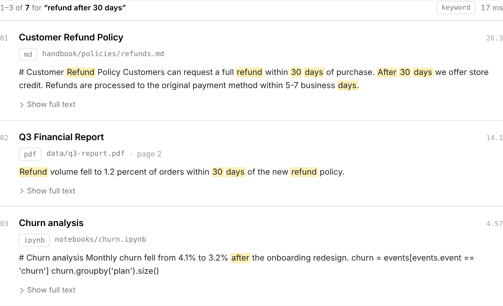
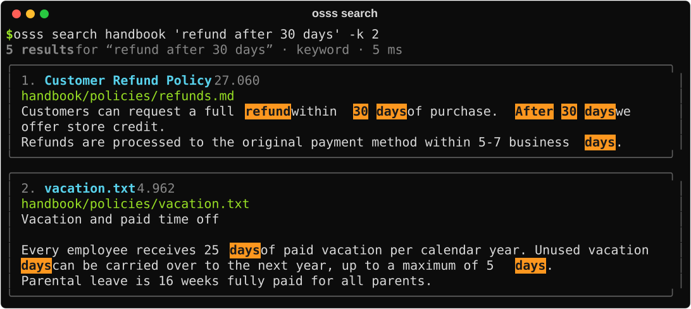

# Searching

```python
idx = cluster.index("handbook")      # or the object returned by create_index
idx.search("refund after 30 days")
```

In a notebook, results display as cards. In a terminal they print as a formatted list. Either way, they're ordinary Python objects you can work with.

{ .shot }

## Query syntax

Plain questions work well. When you need precision:

| You type | It finds |
| --- | --- |
| `refund policy` | Either word (best matches first) |
| `"refund policy"` | The exact phrase |
| `refund -digital` | *refund*, but not documents mentioning *digital* |
| `invoic*` | *invoice*, *invoices*, *invoicing* … |
| `refund \| return` | Either term |
| `(refund \| return) +days` | Grouping, and a required word |

Invalid syntax never errors: osss falls back to matching the words.

## Options

```python
idx.search(
    "refund",
    k=20,                   # number of results (default 10)
    offset=20,              # skip the first 20 (paging)
    mode="keyword",         # "keyword" | "semantic" | "hybrid"
    file_type="pdf",        # or ["pdf", "docx"]
    filters={...},          # see below
    fuzzy=True,             # tolerate typos: "refnud" -> "refund"
    operator="and",         # require all words (default "or")
)
```

**Default mode:** `hybrid` for indexes built with embeddings, `keyword` otherwise. More on the [semantic & hybrid page](semantic.md).

## Filters

Filters narrow results without changing how they're ranked.

```python
idx.search("policy", filters={"folder": "handbook/policies"})
idx.search("tent",   filters={"fields.category": "camping"})          # CSV/JSON column
idx.search("",       filters={"fields.price": {"gte": 20, "lte": 100}})  # numeric range
idx.search("",       filters={"modified": {"gte": "2025-01-01"}})       # recently changed files
```

| Field | Contains |
| --- | --- |
| `file_type` | Extension without the dot: `pdf`, `md`, `csv` … |
| `folder` | Folder path relative to the source, e.g. `reports/2025` |
| `path` | File path relative to the source |
| `source` | Full path or `s3://` URI |
| `page`, `record`, `chunk` | PDF page, CSV/JSON row (from 0), chunk number |
| `modified`, `indexed_at`, `size` | File timestamps and size in bytes |
| `fields.<column>` | Any column from CSV, JSON or Parquet records |
| `metadata.<key>` | Your [custom metadata](metadata.md) (sidecar files or `metadata=`) |

A list means "any of these": `{"file_type": ["pdf", "docx"]}`. A dict with `gte`, `gt`, `lte` or `lt` means a range.

### Filtering on metadata

`metadata=` is a shortcut for `metadata.<key>` filters:

```python
idx.search("parental leave", metadata={"department": "hr"})
idx.search("parental leave", metadata={"department": ["hr", "legal"], "year": {"gte": 2023}})
idx.search("", metadata={"tags": "benefits"})          # list attributes match if they contain the value
idx.search("", metadata={"confidential": False})
```

It's the same as `filters={"metadata.department": "hr", ...}`, and the two can be combined. String values match exactly (case-sensitive). Like CSV/JSON fields, strings that look like numbers or dates are stored as numbers or dates, so filter those with numbers (`{"year": 2024}`) or ranges (`{"published": {"gte": "2024-01-01"}}`).

Metadata filters work the same way in keyword, semantic and hybrid search. More examples, value types and Bedrock filter equivalents are in [Metadata & filtering](metadata.md#4-search-with-filters).

!!! tip "Browse without a query"
    `idx.search("")` (or `idx.sample()`) lists documents. With filters, it returns everything that matches them, for example every camping product under $100.

## Working with results

```python
res = idx.search("refund")

res.total            # total matches
len(res)             # results on this page
res.took_ms          # server time

for hit in res:
    hit.title        # document title, heading or filename
    hit.path         # path relative to the source
    hit.source       # full path or s3:// URI
    hit.page         # PDF page (or None)
    hit.record       # CSV/JSON row number (or None)
    hit.score        # relevance score
    hit.snippet      # HTML with <mark> around matches
    hit.content      # the full chunk text (the parent chunk for hierarchical indexes)
    hit.matched      # hierarchical indexes: the smaller chunk that matched
    hit.fields       # original columns for CSV/JSON/Parquet
    hit.metadata     # your custom metadata, e.g. {"department": "hr", "year": 2024}

res.to_pandas()      # DataFrame, one row per hit
res.to_list()        # list of dicts (e.g. for JSON)
```

## Feeding results to an LLM (RAG)

`context()` turns results into numbered, cited text that you can paste into a prompt:

```python
res = idx.search("What is our refund window?", k=5)
prompt = f"""Answer using only these sources and cite them like [1].

{res.context(max_chars=8000)}

Question: What is our refund window?"""
```

```text
[1] Customer Refund Policy (handbook/policies/refunds.md)
Customers can request a full refund within 30 days of purchase...

[2] Shipping FAQ (web/faq.html)
...
```

Send `prompt` to any model: Amazon Bedrock, a SageMaker endpoint or an API.

## From the terminal

```bash
osss search handbook "refund after 30 days" -k 5
osss search handbook "refund" --type pdf --fuzzy
osss search handbook "refund" --json | jq '.[0].title'
osss search handbook "leave" --meta department=hr --meta year=2024
```

{ .cli }

## Raw OpenSearch queries

osss doesn't hide OpenSearch. The underlying client is right there:

```python
cluster.client.search(index="handbook", body={"query": {"match": {"title": "refund"}}})
```

<div class="next" markdown>
[Metadata & filtering →](metadata.md){ .md-button .md-button--primary }
</div>
