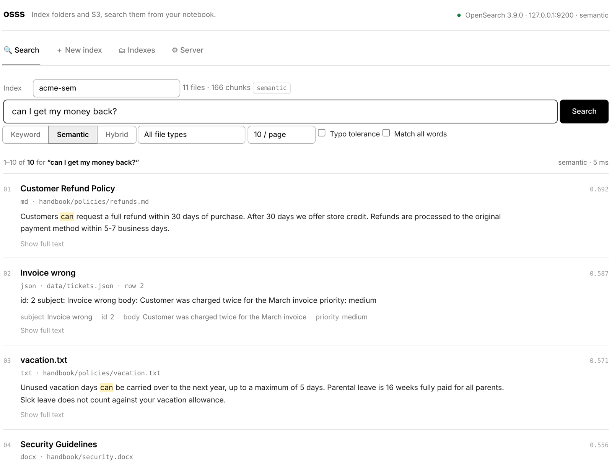
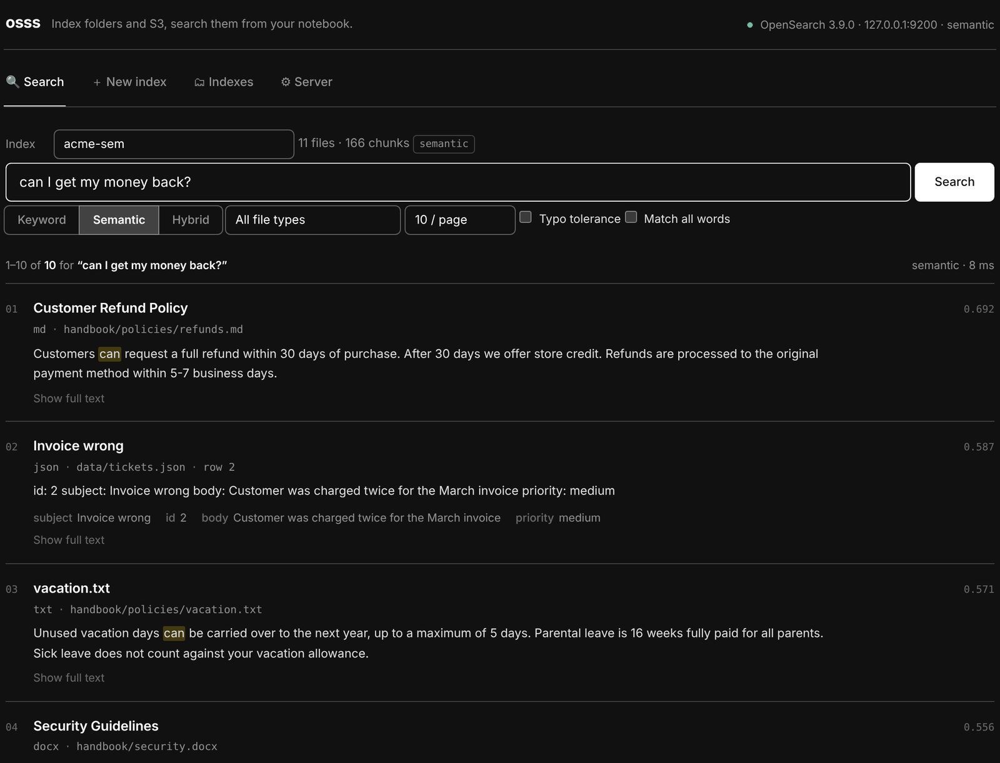

# Semantic & hybrid search

Keyword search finds documents that contain your **words**. Semantic search finds documents that mean the same thing, even when they use different words.

<figure markdown>
  { .shot .shot-light }
  { .shot .shot-dark }
  <figcaption>“can I get my money back?” shares no keywords with the refund policy, but semantic search ranks it first.</figcaption>
</figure>

| Mode | How it works | Best for |
| --- | --- | --- |
| **Keyword** | BM25: matches words, ranks rare words higher | Names, codes, exact phrases, error messages |
| **Semantic** | Compares meaning using embeddings (vectors) | Natural-language questions, synonyms, paraphrases |
| **Hybrid** | Runs both and merges them (reciprocal rank fusion) | A good default when you're unsure |

## Turn it on

<div class="steps" markdown>

### Install a local embedding model (or use Bedrock: skip this step)

```python
%pip install -q "osss[semantic] @ git+https://github.com/utkarsh5026/osss.git"
```

### Start OpenSearch with the k-NN plugin

```python
cluster = osss.start(semantic=True)     # one-time ~1 GB download
```

If keyword-only OpenSearch is already running, osss **upgrades it in place**. Existing indexes are kept.

### Build the index with `semantic=True`

```python
idx = cluster.create_index("handbook-ai", "s3://bucket/handbook/", semantic=True)
```

### Search

```python
idx.search("can I carry unused leave into next year?")   # hybrid by default
idx.search("...", mode="semantic")
idx.search("...", mode="keyword")
```

</div>

In the app, choose **Keyword + Semantic** in step 02 of [New index](app.md#02-configure), then use the **Keyword / Semantic / Hybrid** switch on the Search tab.

## Choosing a model

=== "Local models (sentence-transformers)"

    These run on this machine's CPU, or GPU if there is one. No data leaves the notebook, and there's no per-call cost.

    | Model | Size | Notes |
    | --- | --- | --- |
    | `sentence-transformers/all-MiniLM-L6-v2` *(default)* | 90 MB | Fast, good quality for English |
    | `BAAI/bge-small-en-v1.5` | 130 MB | Better retrieval quality, same speed |
    | `sentence-transformers/all-mpnet-base-v2` | 420 MB | Higher quality, about 4× slower |
    | `sentence-transformers/paraphrase-multilingual-MiniLM-L12-v2` | 470 MB | 50+ languages |

    ```python
    cluster.create_index("kb", "./docs", semantic=True, embedding_model="BAAI/bge-small-en-v1.5")
    ```

    Any [sentence-transformers model](https://huggingface.co/models?library=sentence-transformers) id works. The model downloads once and is cached.

=== "Amazon Bedrock"

    No local model and no `semantic` extra needed; the SageMaker execution role is used.

    | Model id | Dimensions |
    | --- | --- |
    | `amazon.titan-embed-text-v2:0` | 1024 |
    | `cohere.embed-english-v3` | 1024 |
    | `cohere.embed-multilingual-v3` | 1024 |

    ```python
    cluster.create_index("kb", "s3://bucket/kb/", semantic=True,
                         embedding_model="amazon.titan-embed-text-v2:0")
    ```

    !!! warning "Model access"
        Enable the model in the Bedrock console (**Model access**), and give the role `bedrock:InvokeModel` permission.

=== "Your own function"

    Any function that turns a list of strings into a list of vectors:

    ```python
    from osss import FunctionEmbedder

    emb = FunctionEmbedder(lambda texts: my_model.encode(texts).tolist(), name="my-model")
    idx = cluster.create_index("kb", "./docs", embedder=emb)
    ```

    In a new session, register it again before searching:

    ```python
    osss.register_embedder(emb, "custom")
    ```

The model is saved with the index, so searching later automatically uses the same one.

## How hybrid ranking works

Hybrid runs a keyword search and a semantic search, then combines the two ranked lists with **reciprocal rank fusion**: a document's score is the sum of `1 / (60 + rank)` over both lists. Documents that rank well in both rise to the top. Scores are small numbers (around `0.03`), and only their order matters.

## Tips

- **Short, specific chunks embed better.** `chunk_size=500`–`800` is a good range for semantic indexes.
- **Use keyword mode for identifiers.** Order numbers, SKUs and error codes are found more reliably by exact matching.
- **Indexing is slower with embeddings.** A local CPU model handles roughly 100–300 chunks per second. A GPU instance or Bedrock is faster for large collections.
- **Filters work in every mode**, including semantic: `idx.search("cheap tent", mode="semantic", filters={"fields.category": "camping"})`.

<div class="next" markdown>
[Running OpenSearch →](server.md){ .md-button .md-button--primary }
</div>
