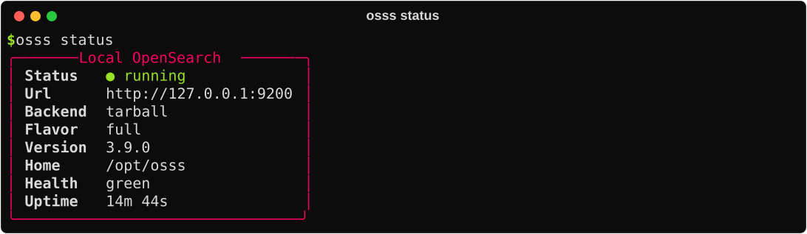

# Running OpenSearch

osss manages a **single-node OpenSearch on this machine**, or connects to one you already have.

## Local server

```python
cluster = osss.start()          # start, or reconnect if it's already running
osss.status()                   # dict with url, version, health, uptime…
osss.stop()                     # stop it; indexes stay on disk
```

```bash
osss start
osss status
osss stop
```

{ .cli }

### It outlives your kernel

The server runs as a separate background process. Restarting the kernel, closing the notebook, or opening a new one doesn't stop it. The next `osss.start()` finds it and reconnects in about a second. Use `osss.stop()` when you want the memory back.

### Options

```python
osss.start(
    semantic=False,      # True adds the k-NN plugin for semantic search
    heap="1g",           # Java memory: "512m", "2g", "4g"…
    port=9200,           # the next free port is used if 9200 is taken
    backend="auto",      # "docker" | "tarball"
    version="3.9.0",     # OpenSearch version
)
```

| Instance memory | Suggested `heap` |
| --- | --- |
| 2–4 GB (e.g. `ml.t3.medium`) | `512m`–`1g` |
| 8–16 GB | `2g` |
| 32 GB+ | `4g`–`8g` |

Keep the heap at no more than half the machine's memory; OpenSearch also uses memory outside the heap.

### Docker or tarball?

| | Docker | Tarball |
| --- | --- | --- |
| Used when | A Docker daemon is reachable | No Docker (SageMaker Studio, Colab…) |
| What runs | `opensearchproject/opensearch` container | Official OpenSearch release with its bundled Java |
| Data | Docker volume `osss-default-data` | `~/.osss/servers/default/data` |
| Semantic search | Always included | Added on demand (k-NN plugin only, to stay lean) |

`backend="auto"` picks Docker when possible, and falls back to the tarball if Docker can't pull the image. Images come from **AWS ECR Public** first (no rate limits, fast from AWS), then Docker Hub. To use a private mirror:

```bash
export OSSS_DOCKER_IMAGE=123456789012.dkr.ecr.us-east-1.amazonaws.com/opensearch:3.9.0
```

### Where things are stored

Everything is under `~/.osss`, or `/opt/osss` when running as root. To change it:

```python
import os
os.environ["OSSS_HOME"] = "/home/sagemaker-user/osss-data"   # before osss.start()
```

```text
~/.osss/
├── downloads/                 OpenSearch archives (reused)
├── dist/                      unpacked OpenSearch
└── servers/default/
    ├── data/                  your indexes
    ├── logs/                  server logs  (osss logs)
    └── config/                generated settings
```

### Running as root

OpenSearch refuses to run as `root`. When the kernel runs as root (Studio Classic, many Docker images), osss starts OpenSearch as the unprivileged `nobody` user automatically. You don't need to do anything.

### Security

The local server listens on `127.0.0.1` only, so it isn't reachable from other machines, and it runs without TLS or passwords. Don't expose its port publicly.

## Connect to an existing cluster

```python
# Amazon OpenSearch Service: requests are signed with your AWS credentials (SigV4)
cluster = osss.connect("https://search-my-domain.us-east-1.es.amazonaws.com")

# Amazon OpenSearch Serverless
cluster = osss.connect("https://abc123.us-east-1.aoss.amazonaws.com")

# Self-managed, with a username and password
cluster = osss.connect("https://opensearch.internal:9200", username="admin", password="…")

# Self-signed certificate
cluster = osss.connect("https://localhost:9200", username="admin", password="…", verify_certs=False)
```

Everything else (creating indexes, searching, the app) works the same. In the app, use **Server → Existing cluster**.

!!! note "Semantic search on a remote cluster"
    Amazon OpenSearch Service and Serverless include k-NN. For self-managed clusters, install the `opensearch-knn` plugin.

## Logs

```python
print(osss.LocalServer().logs(100))
```

```bash
osss logs -n 100
```

In the app: **Server → Logs**.

<div class="next" markdown>
[Command line →](cli.md){ .md-button .md-button--primary }
[SageMaker guide](../sagemaker.md){ .md-button }
</div>
