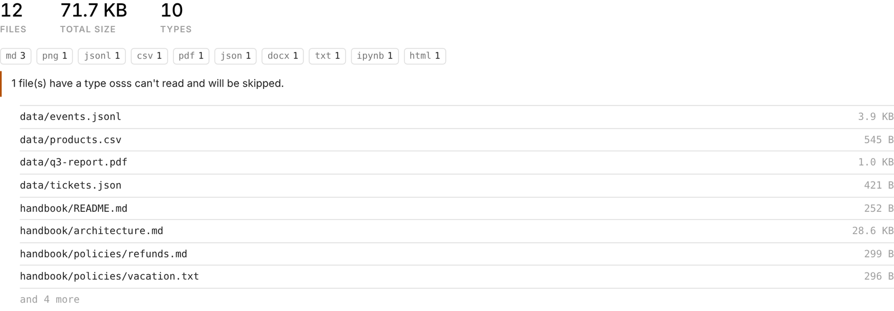

# Folders & S3

osss reads from **local folders**, **single files** and **Amazon S3 prefixes**. Subfolders are always included.

```python
cluster.create_index("docs", "./docs")                      # a local folder
cluster.create_index("docs", "/home/sagemaker-user/data")   # an absolute path
cluster.create_index("docs", "s3://my-bucket/reports/")     # everything under an S3 prefix
cluster.create_index("docs", "s3://my-bucket/q3.pdf")       # a single S3 object
cluster.create_index("docs", ["./notes", "s3://bucket/kb"]) # several sources at once
```

## Preview before indexing

`scan` lists what's in a source without indexing anything:

```python
cluster.scan("s3://my-bucket/reports/")
```

{ .shot }

From the terminal: `osss scan s3://my-bucket/reports/`.

## Amazon S3

osss uses the standard AWS credential chain, so it usually just works:

- **In SageMaker**, the notebook's **execution role** is used. It needs `s3:ListBucket` on the bucket and `s3:GetObject` on the objects.
- **Elsewhere**, run `aws configure`, set `AWS_PROFILE`, or use environment variables.

Large buckets are fine: objects are listed page by page and downloaded **8 at a time** (change this with `workers=`). Only a small window of files is held in memory at once.

??? example "Minimal IAM policy for read-only indexing"
    ```json
    {
      "Version": "2012-10-17",
      "Statement": [
        { "Effect": "Allow", "Action": "s3:ListBucket", "Resource": "arn:aws:s3:::my-bucket" },
        { "Effect": "Allow", "Action": "s3:GetObject",  "Resource": "arn:aws:s3:::my-bucket/*" }
      ]
    }
    ```

To use a specific profile or region, build the source yourself:

```python
from osss import S3Source
cluster.create_index("docs", S3Source("s3://my-bucket/docs/", profile="analytics", region="eu-west-1"))
```

## Supported files

| Type | Extensions | How it's indexed |
| --- | --- | --- |
| PDF | `.pdf` | One document per **page**, so results show the page number. Scanned PDFs without a text layer are skipped with a note. |
| Word | `.docx` | Paragraphs and tables. The title comes from the document properties or the first heading. |
| Markdown & text | `.md` `.txt` `.rst` `.log` … | Whole file. Front matter `title:` or the first `# heading` becomes the title. |
| Web | `.html` `.htm` `.xml` | Visible text only; scripts and styles are removed. Uses `<title>`. |
| Notebooks | `.ipynb` | Markdown and code cells (outputs are ignored). |
| Code & config | `.py` `.js` `.ts` `.java` `.go` `.sql` `.yaml` … | As plain text. |
| Tables | `.csv` `.tsv` `.csv.gz` | One document per **row**, keeping its columns. |
| JSON | `.json` `.jsonl` `.ndjson` `.jsonl.gz` | One document per **record**. A top-level list, or `{"items": [...]}`, is split into records. |
| Parquet | `.parquet` | One document per row. Needs the `parquet` extra. |

Files without an extension (`README`, `LICENSE`) are indexed if they look like text. Images, archives and other binary files are skipped, and listed in the build summary.

## Choosing which files

| Option | Example | Effect |
| --- | --- | --- |
| `include` | `["*.pdf", "reports/**"]` | Only matching files. Patterns without `/` match the file name; others match the path. |
| `exclude` | `["drafts/**", "*.tmp"]` | Skip matching files. |
| `file_types` | `["pdf", "md"]` | Only these extensions. |
| `max_file_mb` | `50` | Skip files over this size. |

Hidden files and folders (`.git`, `.ipynb_checkpoints`), `__pycache__` and `node_modules` are excluded by default.

!!! warning "Overriding `exclude`"
    Passing `exclude=[...]` **replaces** the defaults. To keep them, extend the default list:

    ```python
    from osss.config import DEFAULT_EXCLUDE
    cluster.create_index("docs", "./repo", exclude=DEFAULT_EXCLUDE + ["tests/**"])
    ```

## CSV, JSON and Parquet

Each row or record becomes its own search result, and the original columns are kept. By default every text column is searched. You can be more specific:

```python
cluster.create_index(
    "products", "s3://bucket/catalog.csv",
    text_fields=["name", "description"],   # columns to search
    title_field="name",                     # shown as the result title
    id_field="sku",                         # stable ID: re-indexing updates rows instead of duplicating them
)
```

Columns can then be used as filters:

```python
idx.search("tent", filters={"fields.category": "camping"})
idx.search("", filters={"fields.price": {"lte": 100}})   # ranges work too
```

<div class="next" markdown>
[Building an index →](indexing.md){ .md-button .md-button--primary }
</div>
