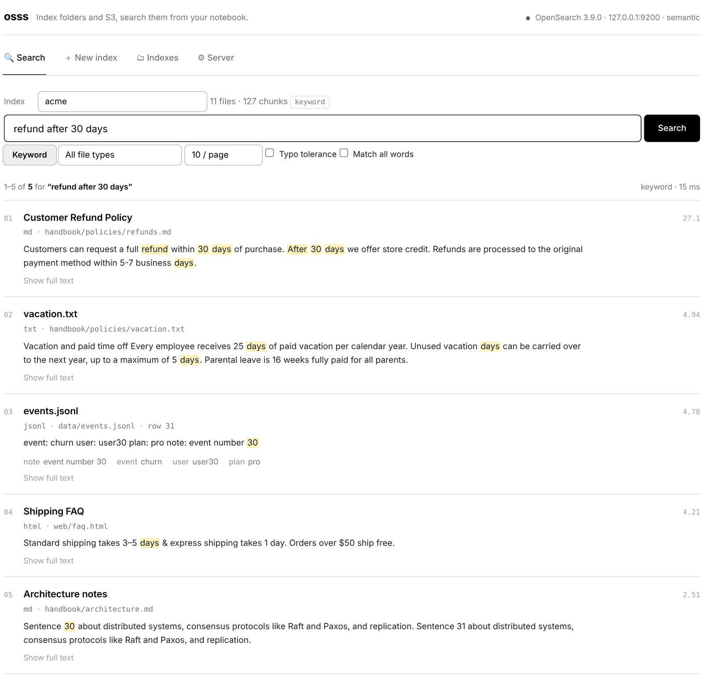
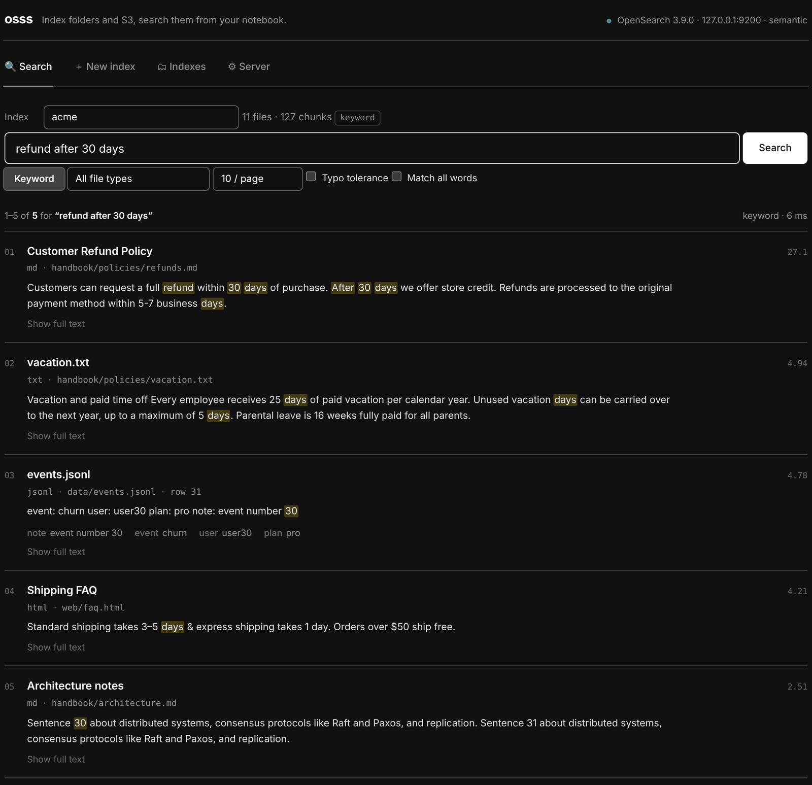
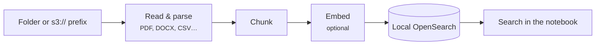

---
hide:
  - navigation
  - toc
---

<div class="hero" markdown>

# Search your documents<br>from your notebook.

<p class="tagline">osss runs OpenSearch for you, indexes a local folder or an S3 bucket, and gives you a clean search interface right inside SageMaker, JupyterLab, VS Code or Colab.</p>

[Get started in 5 minutes](getting-started/quickstart.md){ .md-button .md-button--primary }
[Installation](getting-started/installation.md){ .md-button }

</div>

```python
%pip install -q "osss @ git+https://github.com/utkarsh5026/osss.git"

import osss
osss.ui()
```

<figure markdown>
  { .shot .shot-light }
  { .shot .shot-dark }
  <figcaption>The osss app in JupyterLab: matches highlighted, file and page for every hit.</figcaption>
</figure>

<div class="features" markdown>

<div markdown>
### :material-console-line: One command
`pip install`, then `osss.start()`. No Docker, Java or cluster to set up; osss downloads and runs OpenSearch for you.
</div>

<div markdown>
### :material-folder-search-outline: Any folder or bucket
Local paths or `s3://` prefixes. Supports PDF, Word, Markdown, HTML, CSV, JSON, Parquet, notebooks and code.
</div>

<div markdown>
### :material-tune-variant: Real control
Choose the chunk size, language analyzer, file filters, which CSV/JSON columns to search, and shards. Sensible defaults for all of them.
</div>

<div markdown>
### :material-brain: Keyword, semantic, hybrid
BM25 out of the box. Add embeddings from a local model or Amazon Bedrock to search by meaning.
</div>

<div markdown>
### :material-restart: Survives restarts
The server keeps running and your indexes stay on disk. Restart the kernel and you're back in a second.
</div>

<div markdown>
### :material-aws: Made for SageMaker
Works in Studio, where Docker isn't available, and on notebook instances. S3 and Bedrock use your execution role, so no keys are needed.
</div>

</div>

## How it works



1. **Point** osss at your data and preview what's there.
2. **Configure** how it's indexed, or keep the defaults.
3. **Search** with keyword, semantic or hybrid queries, from the app or from Python.

<div class="next" markdown>
[Install osss →](getting-started/installation.md){ .md-button .md-button--primary }
[Take the app tour](guide/app.md){ .md-button }
[Using SageMaker?](sagemaker.md){ .md-button }
</div>
